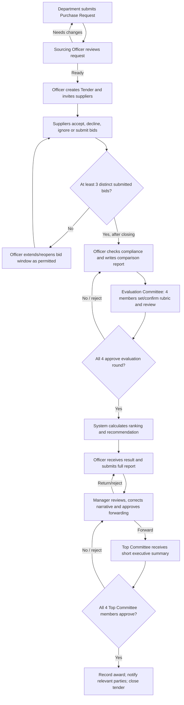

# Orange Sourcing & Tender Management System

> **Academic / training project** — an Orange-inspired procurement workflow, **not** an official Orange production system or an assertion of affiliation. The provided assignment brief uses Orange as a proposed company scenario and labels the document “Orange Restricted”; keep the original brief within the team.

A role-based web application that manages the full internal sourcing lifecycle: department purchase requests, supplier invitations, competitive offers, evaluation by a **four-member technical/financial committee**, system-generated supplier ranking, Sourcing Officer review, Sourcing Manager review, and **unanimous approval by a separate four-member Top Committee** before awarding a tender.

The implementation is planned for a **seven-person development team** using **ASP.NET Core MVC, C#, SQL Server, Entity Framework Core (Code First), and ASP.NET Core Identity**.

> **Documentation precedence:** (1) the product-flow clarifications supplied by the project owner, (2) the attached `Sourcing_Tender_Management_System_English_Brief_V5 (1).docx` for any matters not overridden, (3) explicit decisions recorded in [`docs/DECISIONS_AND_SCOPE.md`](docs/DECISIONS_AND_SCOPE.md), and (4) implementation choices. Do **not** silently reinterpret conflicts or finalize undecided scoring rules.

## 1. Read this first

| File | Purpose |
| --- | --- |
| [`CLAUDE.md`](CLAUDE.md) | Mandatory working context and guardrails for Claude Code. |
| [`AGENTS.md`](AGENTS.md) | Short entry point for Codex/other coding agents. |
| [`docs/WORKFLOW.md`](docs/WORKFLOW.md) | Canonical step-by-step lifecycle, statuses, returns, and resubmissions. |
| [`docs/DATA_MODEL.md`](docs/DATA_MODEL.md) | Proposed EF Core / SQL Server entities, keys, relationships, and constraints. |
| [`docs/EVALUATION_AND_APPROVALS.md`](docs/EVALUATION_AND_APPROVALS.md) | Configurable scoring architecture and both committees' **4/4** approval rules. |
| [`docs/SECURITY_AND_REQUIREMENTS.md`](docs/SECURITY_AND_REQUIREMENTS.md) | Identity, RBAC, isolation, mandatory biometric/AI/voice/clarification requirements. |
| [`docs/IMPLEMENTATION_PLAN.md`](docs/IMPLEMENTATION_PLAN.md) | Modules, seven-person ownership proposal, delivery milestones, tests, and demo. |
| [`docs/DECISIONS_AND_SCOPE.md`](docs/DECISIONS_AND_SCOPE.md) | Confirmed requirements, intentional differences from the brief, open decisions, and deferred options. |

These files are the **project specification and implementation guidance**, not completed source code. They should be committed at the repository root with the `docs/` folder.

## 2. Problem and business context

Orange's internal departments (for this scenario: IT, Network Operations, HR, Finance, Facilities, etc.) need equipment, materials, software licenses, and services. A department representative submits a structured Purchase Request. Sourcing coordinates the tender, invites eligible suppliers, collects their offers, and produces an evidence-based comparison. Two separate four-person committees handle evaluation and final approval; the application tracks every action and ultimately records the awarded supplier.

**Illustrative case:** Network Operations requests 20 network switches. The Sourcing Officer creates a tender and invites five suppliers. Three or more distinct suppliers submit bids. The Officer checks compliance and prepares a comparison report. Four evaluation members review the bids, define/confirm the scoring weights for that evaluation round, enter the required evaluations, and unanimously approve the finalized evaluation. The application calculates a ranked recommendation. The Officer forwards the detailed result to the Sourcing Manager, who reviews/corrects the managerial narrative and sends a short executive summary to the Top Committee. **All four Top Committee members must approve** before an award is recorded.

## 3. Non-negotiable product rules

1. **Supplier-only public registration:** suppliers may self-register; internal users are provisioned and assigned roles by Admin. Supplier accounts require Admin approval before participating.
2. **Department origin:** an authorized employee creates a Purchase Request for their department. It goes **directly to the Sourcing Officer**, who can review, return for clarification, or start a tender. There is no separate mandatory department-approver gate.
3. **Invite-only bids:** a supplier can see only tenders for which it has an invitation; it can accept, decline, or ignore an invitation. Ignoring does not create an offer.
4. **Three-offer gate:** at least **three different invited suppliers** must have submitted offers before the Officer may forward the tender to formal evaluation. Three invitations alone do not satisfy the gate. An offer from a non-compliant supplier still counts as received for this minimum, but is **not eligible to win**. If there are fewer than three offers, continue/extend the bid window through an explicit Officer action; do not fabricate bids or auto-advance.
5. **Officer prepares first report:** after close/submission checks, the Officer performs document/compliance review and produces the **initial bid-comparison report** for the Evaluation Committee.
6. **Evaluation Committee:** exactly four assigned people, representing the technical/financial evaluation function, distinct from the Top Committee. They examine the Officer's report, configure/confirm **weights whose exact values are not decided yet**, evaluate compliant bids, and **all four approve** the round before its result can progress. The system calculates and ranks scores; it **recommends** a supplier rather than making an irreversible award.
7. **Officer review after evaluation:** the complete evaluation and ranked recommendation return to the Sourcing Officer, who submits the full report to the Sourcing Manager.
8. **Manager review:** the Sourcing Manager may correct/clarify report narrative, return it for revision, reject it for demo purposes, or forward a **short executive summary** to the Top Committee. The Manager must not silently modify frozen committee scores or votes.
9. **Top Committee:** exactly **four other assigned people**; **4/4 Approve** is required to award. There is no majority or 3/4 approval result. A Reject button exists for the demonstration and must follow a recorded return/rejection path.
10. **No retroactive overwrites:** return, correction, re-submission, vote, and report changes create new versions/rounds where required; history and audit records remain available.
11. **Access isolation:** suppliers never view other suppliers' invitations, bid prices, attachments, evaluations, or confidential results.
12. **Authoritative ranking:** final deterministic scores come from validated application data and a committee-approved rubric. Ollama may analyze/assist but must never silently choose the winner or override the committee.

A concrete state diagram and return paths are in [`docs/WORKFLOW.md`](docs/WORKFLOW.md).

## 4. Actor model

| Actor | Principal responsibilities |
| --- | --- |
| **Admin** | Internal user provisioning and role assignment; departments; supplier registration review/approval/suspension; master data; audit visibility as permitted. No evaluation vote by default. |
| **Department Representative** | Draft/submit Purchase Requests, add line items, review status, reply to clarifications and revise returned requests. Scoped to its department/own assigned requests. |
| **Sourcing Officer** | Review requests; create/publish tenders; invite suppliers; receive bids; perform compliance checks; author comparison/full reports; submit to evaluation and manager; manage permitted resubmissions. |
| **Supplier** | Register company; await approval; view **own** invitations; accept/decline or ignore; draft/submit own offers and documents; track own outcomes. |
| **Evaluation Committee Member** | One of exactly four tender-assigned technical/financial evaluators; review initial comparison, weigh/score criteria according to finalized rubric, write observations, cast approve/reject. |
| **Sourcing Manager** | Receive completed evaluation via Officer; review/correct managerial portions, return/reject or forward the concise report to the Top Committee. Separate stage from evaluation committee. |
| **Top Committee Member** | One of exactly four separately assigned decision makers; view an executive summary and supporting information allowed by role; approve/reject, with 4/4 needed for award. |

Users may have global Identity roles, but an evaluation/top vote must ALSO require an explicit **assignment to that tender and review round**. Role alone is insufficient.

## 5. End-to-end workflow



The real workflow must not advance when a prerequisite is unmet. No tender award is permitted until both committee rounds have **four recorded approvals** and the manager has forwarded the report. Full transitions and exceptional paths: [`docs/WORKFLOW.md`](docs/WORKFLOW.md).

## 6. Evaluation and weighting: configurable, **not yet fixed**

The team has **not decided** the final weighting method, technical-vs-financial ratio, detailed criteria, per-member score aggregation, or financial price normalization. **60% technical / 40% financial is only an example**, never a hardcoded policy.

The data model must permit a committee-approved evaluation configuration **per tender/per evaluation round**, with technical and financial criteria, weights and scores saved separately, and a fully explainable calculation. The UI should present a breakdown for every eligible supplier, ranking, and reason for recommendation. If there is a tie, unresolved formula, missing score, or incomplete unanimous approval, the system must **block finalization**, not guess.

For planning only, a possible shape is `FinalScore = TechnicalWeight × TechnicalScore + FinancialWeight × FinancialScore` (weights normalized to 0..1, scores to 0..100). This is a **candidate design**, not a signed-off formula. See [`docs/EVALUATION_AND_APPROVALS.md`](docs/EVALUATION_AND_APPROVALS.md).

## 7. Technology and architecture

| Area | Selected approach |
| --- | --- |
| Web | ASP.NET Core MVC, Razor Views, C#, server-rendered UI; JavaScript for approved interactive features. |
| Database | Microsoft SQL Server. |
| Data access | Entity Framework Core, **Code First**, migrations tracked in Git. |
| Identity | ASP.NET Core Identity + cookie-based authentication + policy/resource authorization. |
| Code structure | Single web solution using feature/module folders with clear services, domain entities, view models and repositories/EF queries; avoid unnecessary microservices. |
| File storage | Protected storage **outside `wwwroot`**; metadata/ownership in database; access-checked download actions. |
| AI | Local Ollama integration for advisory bid analysis, isolated behind an application service. |
| Voice | Browser SpeechRecognition / Web Speech API with graceful unsupported-browser fallback. |
| Biometric | **Both face and fingerprint login experiences** are assignment requirements; final implementation must prove real identity verification and reject static face-image uploads. See feasibility notes in security docs. |
| Testing | xUnit or equivalent; service/domain unit tests + integration tests around SQL Server/EF constraints and role permissions. |

**Implementation conventions:** use UTC for stored timestamps and format dates in the UI; decimal for money and weights (not float); normalized statuses/enums; `RowVersion` for contested edits where appropriate; model validation on the server; no business decisions based only on front-end checks. Separate `Controller` → `Application Service` → `DbContext`/domain logic. Do not put ranking, permission, or state-transition code in Razor views.

A proposed code layout (adapt it to the existing repo rather than blindly overwriting existing work):

```text
/src/Orange.TenderManagement.Web/
  Areas/                       # optional organization by role; not mandatory
  Controllers/
  Views/
  ViewModels/
  Features/                     # PurchaseRequests, Tenders, Bids, Evaluations, ...
  Services/
  Domain/                       # Entities, Enums, Policies, Rules
  Infrastructure/
    Persistence/                # ApplicationDbContext, Configurations, Migrations
    Identity/
    Storage/
    AI/
  wwwroot/                      # public static assets only, NEVER confidential uploads
/tests/Orange.TenderManagement.Tests/
/docs/
CLAUDE.md
AGENTS.md
README.md
```

If an existing solution structure already exists, retain its convention and implement equivalent boundaries.

## 8. Core data areas

The attached brief's tables are **suggestions, not an untouchable schema**. The normalized proposal covers:

- **Accounts and organizations:** Identity tables, departments, supplier company profiles, supplier legal documents and verification.
- **Requests:** purchase request header, line items, and request-specific attachments.
- **Tendering:** tenders, tender items/specifications, invitations (do not redundantly split `TenderSuppliers` and `Invitations`), supplier bids and immutable bid revisions/items/documents.
- **Compliance and evaluation:** compliance reviews, tender-specific committee membership, evaluation rounds, criteria, scores, committee review rounds/votes, versioned reports and manager actions.
- **Outcome:** recommended supplier (computed and snapshot in evaluation report) vs awarded supplier (created only after final approval).
- **Cross-cutting:** clarification threads/messages, notifications, audit logs, advisory AI analyses, biometric credential metadata where required.

See [`docs/DATA_MODEL.md`](docs/DATA_MODEL.md) for **entity-level relationships, constraints, delete behavior, and suggested indexes**. Do not implement every entity simultaneously; each feature slice can add a migration.

## 9. Screens and dashboards

| Public / role | Core pages |
| --- | --- |
| **Public** | Home, About, How It Works, Contact, Login, Supplier Registration. Public statistics, if shown, use actual non-confidential database counts. |
| **Admin** | Dashboard, Departments, Employees/Roles, Pending Supplier Applications, Approved/Suspended Suppliers, Supplier Documents, Audit overview. |
| **Department** | Dashboard, New Purchase Request, Request Items, My/Department Requests, Request Details/History, Clarifications. |
| **Sourcing Officer** | Task Dashboard, Incoming Requests, Tender Create/Edit, Invitations, Offer Inbox, Bid Comparison/Compliance, Officer Report, Evaluation Progress, Manager Submission, Return Queue. |
| **Supplier** | Registration/Profile, My Invitations, Invitation Detail, Accept/Decline, Offer Editor, My Submitted Bids, My Documents/Clarifications. |
| **Evaluation Committee** | Assigned Tenders, Full Comparison Report, Technical/Financial Criteria & Weights, Scoring, Results/Ranking, Four-Member Approval Tracker, Clarifications. |
| **Sourcing Manager** | Pending Reports, Full Detailed Report, Edit/Correct Narrative, Return/Reject/Forward, Executive Summary Preview, History. |
| **Top Committee** | Assigned Decision Queue, **Short Executive Summary**, Key Comparison/Ranking, Four-Member Approval Tracker, Decision History, Management Statistics. |

Dashboards and reports must use **real database data** and apply server-side scope filters. UI should be modern, accessible, responsive, and consistent with Orange-inspired styling while respecting use of brand assets.

## 10. Assignment-required features (NOT optional)

The attached brief names **four mandatory advanced requirements**. All are in scope, even if their delivery is scheduled after the core workflow:

1. **Face recognition and fingerprint authentication:** linked to individual accounts, real verification, secure failures, both entry options on login, **no static photo accepted as live face verification**. Platform biometric passkeys/WebAuthn can be part of the solution, but on their own do **not** prove which biometric modality was used. The team must choose a demonstrable architecture rather than a fake UI.
2. **Ollama AI bid analysis:** compare bids, extract price/specifications/delivery/missing documents, flag strengths and weaknesses, generate *advisory* analysis. Never alter deterministic scoring/award or release competing bids to suppliers.
3. **Voice search for Employee Dashboard tasks:** supported `SpeechRecognition` implementation with permission handling, text fallback and safe search scope.
4. **Role-based clarification/inquiry:** department ↔ officer, officer ↔ evaluation committee, evaluation committee ↔ manager, manager ↔ Top Committee, officer ↔ supplier, with process context, replies, statuses, notifications and audit.

Detailed acceptance criteria and security boundaries: [`docs/SECURITY_AND_REQUIREMENTS.md`](docs/SECURITY_AND_REQUIREMENTS.md).

## 11. Optional assignment features — explicitly **deferred**

The original brief states **at least two** of the three options should eventually be completed. The team's **initial development scope excludes all optional features**. They are documented here for planning, not authorized for implementation now:

| Optional feature | Definition | Current status |
| --- | --- | --- |
| QR code | Tender or Purchase Request quick-access code; authorization still applies. | **Deferred** |
| Digital signatures | Electronic signing of documents/decisions. | **Deferred** |
| Personalized watermark | On viewed/downloaded tender docs/reports, include accessing user's identifying details. | **Deferred** |

Before the final academic assessment, the team must explicitly select **two** of these if the original grading rubric remains in force. Do not implement them until requested or scoped as a later milestone.

## 12. Core reports and analytics

- Requests: counts by status, department, ownership, dates and processing time.
- Tenders: draft/open/closed/awarded, no-bid tenders, participation rate, overdue evaluations.
- Suppliers: registration/approval/suspension, document verification and expiration, invitation and award history.
- Bids: side-by-side prices, specifications, delivery time, compliant vs excluded offers, evaluation result breakdown.
- Governance: committee membership, 4/4 decisions, manager actions, complete audit, award history.
- Top Committee management view: totals by suppliers and frequency of awarded transactions per supplier; non-confidential aggregations and role-appropriate filtering.
- Search/filter and export to PDF/Excel are in the assignment reporting expectations; plan them after dependable report data, respecting document download authorization.

## 13. Getting started (once application code exists)

1. Install a team-agreed .NET SDK, SQL Server (or SQL Server Developer/Express) and IDE. **Do not pin a version before the team confirms the repo's TargetFramework.**
2. Copy `appsettings.Development.example.json` (if added to the repo) to a local ignored config, or use `.NET User Secrets`/environment variables for connection strings and provider tokens.
3. Restore and build with `dotnet restore` and `dotnet build` at the solution root.
4. Create the database via tracked EF Core migrations (`dotnet ef database update`, with explicit project/startup flags when required).
5. Run the app with `dotnet run --project <path-to-web-project>` after the solution structure has been finalized.
6. Seed **demonstration-only** roles, departments, internal employees, two separate committees with four members each, and test suppliers. Never commit plaintext or reusable passwords.
7. Test the complete workflow with at least three independent invited supplier companies and **both** positive and negative approval paths.

No specific `.sln`, `.csproj`, .NET version, configured environment variable names or CLI paths are asserted here: these will be updated after inspecting the actual repository.

## 14. Collaboration and definition of done

Seven-person workstream proposal: Identity/Admin; Department Requests; Tender/Invitations; Supplier/Bids; Compliance/Evaluation Engine; Reports/Committees/Approvals; Cross-Cutting Integrations/QA. These are proposed ownership domains, not exclusive coding silos. Use a shared entity/permission contract before parallel work, feature branches, reviewed pull requests and small Code First migrations with team coordination. See [`docs/IMPLEMENTATION_PLAN.md`](docs/IMPLEMENTATION_PLAN.md).

A feature is complete only when its server-side authorization, data validation, state transitions, ownership checks, error states, audit coverage, test cases, and UI behavior are verified. A button or mock dashboard alone does not satisfy a mandatory feature.

## 15. Evaluation and presentation

The original brief describes a **15-minute project presentation** (5-minute slides + 10-minute live demo), followed by approximately **10 minutes of individual technical discussion per student**. Every team member should understand their own code, migrations, authorization checks, and relevant end-to-end business rules.

A live demo should cover an Orange-themed request; multiple invitations; at least three **real database-backed** supplier submissions; compliance; configurable committee evaluation; four unanimous evaluation approvals; system recommendation; Officer → Manager → executive summary; four unanimous Top Committee approvals; award; and a separate rejection/resubmission example. Show mandatory AI, voice search, biometric and clarification capabilities as implemented, without simulating secure authentication or AI decisions.

## 16. Key unresolved decisions

The team must confirm before building the relevant behavior: scoring formula/criteria and member score aggregation, how to resolve ties, exact distribution of technical vs finance responsibilities among the four evaluation members, supplier bid reopening rules after closure, whether three **eligible** bids (versus three submitted bids) are needed for grading, and the concrete biometric provider/device approach. Each decision should be recorded in [`docs/DECISIONS_AND_SCOPE.md`](docs/DECISIONS_AND_SCOPE.md) and followed by updated tests and schema as needed.

---

**Reference:** `Sourcing_Tender_Management_System_English_Brief_V5 (1).docx` (9 pages), supplemented and intentionally overridden where noted by the project owner's clarified flow. **This README is a planning baseline**, not evidence that features are already implemented.
