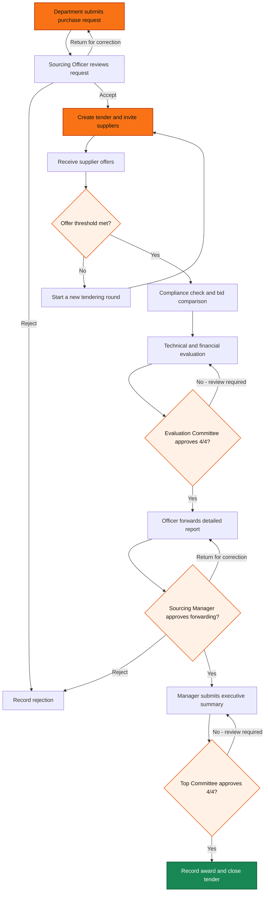
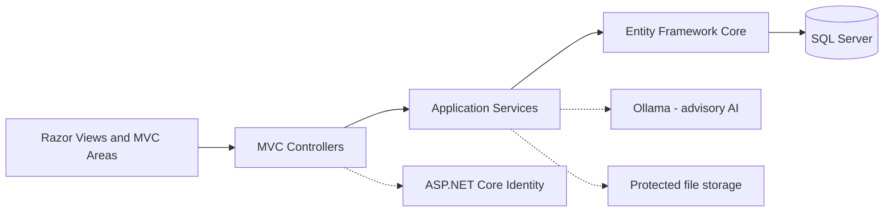

<p align="center">
  
</p>

<h1 align="center">Orange Sourcing &amp; Tender Management System</h1>

<p align="center">
  <strong>Smarter sourcing. Transparent evaluation. Accountable decisions.</strong>
</p>

<p align="center">
  An Orange-inspired academic web application designed to streamline the procurement lifecycle,<br />
  from internal purchase requests to supplier selection and final tender awards.
</p>

<p align="center">
  
  
  
</p>

<p align="center">
  <a href="https://trello.com/b/407Mnreu/tender-management-system"></a>
  <a href="https://www.figma.com/design/Y5JTY3OI3hNdjhnKm58JSs/Mockup-Wirefame?node-id=38-146&amp;t=yAbTlF6D0z43nVR7-1"></a>
</p>

<p align="center">
  <a href="#about-the-project">Overview</a> •
  <a href="#core-features">Features</a> •
  <a href="#procurement-workflow">Workflow</a> •
  <a href="#technology-stack">Tech Stack</a> •
  <a href="#getting-started">Setup</a> •
  <a href="#meet-the-team">Team</a>
</p>

---

## About the Project

Procurement often involves multiple departments, suppliers, documents and approval stages. Managing these activities through disconnected tools makes it difficult to track progress and maintain a reliable decision history.

The **Sourcing & Tender Management System** brings these activities into a centralized, role-based web application. It is designed to make sourcing more efficient, supplier evaluation more consistent, and procurement decisions easier to trace.

> One platform. Every stage of the tender lifecycle. A clear record of every decision.

## Core Features

The following modules describe the intended product scope, rather than a claim that every feature has already been delivered.

| Module | Capability |
| :--- | :--- |
| 📝 **Purchase Requests** | Create, submit, review, return and track departmental purchase requests. |
| 📋 **Tender Management** | Manage tender requirements, deadlines, supplier invitations and retendering rounds. |
| 🏢 **Supplier Portal** | Register companies, verify documents and allow approved suppliers to participate in tenders. |
| 📦 **Bid Management** | Collect supplier offers, technical proposals, pricing and supporting documents. |
| 🔎 **Compliance & Comparison** | Review mandatory requirements and compare eligible offers across technical and financial dimensions. |
| ⚖️ **Committee Evaluation** | Configure evaluation criteria, record scores and prepare consolidated recommendations. |
| ✅ **Approval & Award** | Support documented management reviews and unanimous committee decisions before final award. |
| 📊 **Reporting & Analytics** | Provide role-specific dashboards, procurement histories and authorized PDF/Excel exports. |
| 🔔 **Notifications & Audit Trail** | Keep relevant users informed and preserve traceable actions, revisions and decisions. |

### Advanced Capabilities

| Capability | Purpose |
| :--- | :--- |
| 🔐 **Biometric Authentication** | Planned face-recognition and fingerprint-verification login paths, subject to secure implementation and device support. |
| 🤖 **AI-Powered Bid Analysis** | Use Ollama to assist with extracting, comparing and summarizing bid information. Human committees retain decision authority. |
| 🎙️ **Voice Search** | Enable speech-to-text search for employee tasks, with a text-search alternative. |
| 💬 **Role-Based Clarifications** | Support controlled inquiries and responses between authorized participants at each workflow stage. |

## Procurement Workflow



The workflow includes controlled correction paths, distinct tendering rounds, compliance screening and a documented evaluation-to-award process. Only eligible offers may receive an award, and AI-generated recommendations cannot replace human approval.

## System Roles

| Role | Responsibility |
| :--- | :--- |
| **Admin** | Manage accounts, roles, departments and supplier verification. |
| **Requesting Department** | Submit purchase requests and track their progress. |
| **Sourcing Officer** | Review requests, manage tenders, invite suppliers and compare bids. |
| **Supplier** | Respond to invitations, submit offers and track permitted bid history. |
| **Evaluation Committee** | Perform technical and financial evaluation and approve recommendations. |
| **Sourcing Manager** | Review consolidated reports and prepare executive summaries. |
| **Top Committee** | Review recommendations and make final collective award decisions. |

The application is designed around server-side role-based authorization, record ownership, supplier isolation and committee-specific permissions.

## Technology Stack

<p align="center">
  
  
  
  
  
  <br />
  
  
  
  
  
</p>

| Layer | Technology |
| :--- | :--- |
| Frontend | Razor Views, HTML, CSS and JavaScript |
| Backend | ASP.NET Core MVC / C# (.NET 10) |
| Database | Microsoft SQL Server |
| Data Access | Entity Framework Core, Code First migrations |
| Authentication | ASP.NET Core Identity |
| Advanced integrations | Ollama and browser Speech Recognition (planned) |
| Collaboration & Design | Git, GitHub, Trello and Figma |

### Application Architecture

The project follows a single ASP.NET Core MVC application with role-based Areas and shared layouts. The intended application-service pattern keeps business rules separate from presentation and database access.



## Getting Started

### Prerequisites

- .NET 10 SDK
- Microsoft SQL Server and a locally accessible database instance
- Git
- Visual Studio or another .NET-compatible editor
- EF Core CLI tools compatible with the project version

### Local Setup

**1. Clone the repository.**

```bash
git clone https://github.com/Tender-Management-G2/Orange-Tendering-System.git
cd Orange-Tendering-System
```

**2. Restore dependencies.**

```bash
dotnet restore
```

Run the remaining project-specific commands from the directory that contains the web application's `.csproj` file (or supply the project path explicitly).

**3. Configure SQL Server locally.**

Set the `ConnectionStrings:Default Connection` configuration key with the correct SQL Server instance. The following is a local Windows Authentication example using .NET user secrets:

```bash
dotnet user-secrets init
dotnet user-secrets set "ConnectionStrings:Default Connection" "Server=localhost;Database=OrangeTenderingSystem;Trusted_Connection=True;TrustServerCertificate=True"
```

Skip `init` if user secrets are already initialized. Adapt the connection to your environment and never commit passwords or production credentials. `TrustServerCertificate=True` is for this local development example only.

**4. Apply the existing Code First migrations.**

```bash
dotnet ef database update
```

If the EF CLI is missing, install a `dotnet-ef` version compatible with the project's EF Core packages.

**5. Build and launch.**

```bash
dotnet build
dotnet run
```

Open the local URL printed in the terminal. Role-based workspaces require the appropriate Identity roles and authorized development accounts. Check the project's current initialization and seeding instructions before testing protected pages.

## Development Roadmap

The project is under active development. The documented baseline includes the MVC foundation, Code First data model and role-based page scaffolding. Functional completion will be tracked separately from the existence of a page or database table.

| Phase | Scope |
| :--- | :--- |
| **01 — Foundation** | MVC setup, data model, migrations and shared UI scaffolding. |
| **02 — Core Procurement** | Requests, supplier verification, tender rounds, invitations, bids and compliance. |
| **03 — Evaluation & Governance** | Scoring, committee voting, report handoffs and final awards. |
| **04 — Advanced Features** | Biometrics, Ollama, voice search, clarifications and reporting. |
| **05 — Quality & Delivery** | Integration testing, security checks, responsive refinement and demonstration preparation. |

Follow the [Trello project board](https://trello.com/b/407Mnreu/tender-management-system) for current task ownership and progress.

## Meet the Team

<p align="center"><strong>Seven people. One shared vision.</strong></p>

| Team Member | Project Role |
| :--- | :--- |
| **Saja** | 🧭 Scrum Master |
| **Sara D** | 🎯 Product Owner |
| **Haya** | 🛡️ Quality Assurance |
| **Amal** | 💻 Developer |
| **Ahmad** | 💻 Developer |
| **Tariq** | 💻 Developer |
| **Sara Rjoub** | 🎯 Product Owner |

Our team works collaboratively through Agile planning, transparent task ownership, feature development, code review and quality assurance.

## Project Resources

| Resource | Description |
| :--- | :--- |
| [**Trello — Project Board**](https://trello.com/b/407Mnreu/tender-management-system) | Sprint planning, tasks, assignments and progress tracking. |
| [**Figma — Mockups & Wireframes**](https://www.figma.com/design/Y5JTY3OI3hNdjhnKm58JSs/Mockup-Wirefame?node-id=38-146&t=yAbTlF6D0z43nVR7-1) | UI/UX concepts, layouts, mockups and wireframes. |

## Team Development Workflow

Use feature branches, small meaningful commits and reviewed pull requests. Coordinate shared changes to database migrations, authentication and layouts, and validate the build before merging.

```text
Plan → Design → Develop → Review → Test → Merge
```

## Disclaimer

This is an independent academic/training project inspired by a telecommunications procurement scenario. It is not an official Orange product and does not imply affiliation, endorsement or partnership with Orange.

---

<p align="center">
  <strong>Built with collaboration, curiosity and a commitment to quality.</strong><br />
  <sub>Orange Sourcing &amp; Tender Management System • Team Project • 2026</sub>
</p>

<p align="center"><a href="#about-the-project">Back to overview ↑</a></p>
