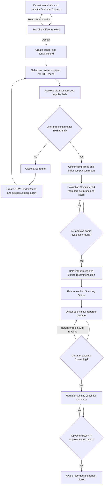

# Orange Sourcing & Tender Management System

**Canonical project specification — consolidated and corrected**  
**Version:** 2.0 — 13 November 2026  
**Project type:** Academic / training project  
**Technology:** ASP.NET Core MVC, C#, Microsoft SQL Server, Entity Framework Core (Code First), ASP.NET Core Identity  
**Team:** 7 developers  
**Implementation baseline reviewed:** GitHub `Tender-Management-G2/Orange-Tendering-System`, `main` at commit `78dd7008ecf07cef613297bf26e42134cb9c169c`.

> **Important identity disclaimer:** This is an Orange-inspired academic scenario, **not** an official Orange system or a claim of affiliation. The original assignment document is labelled “Orange Restricted”; do not publish or redistribute its original contents outside the authorized team without permission. This Markdown file is a rewritten project specification for team use.

> **Scope rule:** The complete procurement workflow and all four mandatory advanced requirements remain in scope. The three assignment **optional** requirements are deferred for now. A scaffolded page, a passing build, or a database table **does not** mean its business functionality has been implemented.

---

## 1. Source of truth, decisions and document locations

This is the **single consolidated product specification** for the repository. No separate `docs/WORKFLOW.md`, `docs/DATA_MODEL.md`, `docs/EVALUATION_AND_APPROVALS.md`, `docs/SECURITY_AND_REQUIREMENTS.md`, `docs/DECISIONS_AND_SCOPE.md`, or `docs/IMPLEMENTATION_PLAN.md` is required to understand the business rules in this file; references to those **nonexistent** specification files have been removed.

The following sources were consolidated:

1. **Project-owner decisions in the conversation** — highest authority where they intentionally modify older rules: retendering, minimum submitted offers, four-member committees, the Sourcing Manager's membership, criterion ownership, immutable submitted reports and correction permissions, technology choice and simplicity.
2. **Original assignment:** `Sourcing_Tender_Management_System_English_Brief_V5 (1).docx` — all mandatory requirements and detailed responsibilities unless explicitly superseded by an owner decision.
3. **Previous specification:** the older `TenderingOrangeSystem.md` — its workflow refinements, report stages and security model, excluding superseded or erroneous assumptions.
4. **Current code:** existing EF Core entities, `ApplicationDbContext`, `Models/SystemRoles.cs`, migrations and MVC scaffold — source of truth for **what is already implemented**, not authority for changing business requirements.
5. **Team assignment snapshot:** `Tender_Management_Team_README (1).md`, dated 13 November 2026, which records 60 Trello cards and their actual links. Card ownership describes **developers**, not the end-users permitted to act.

Repository documentation **currently** includes generated handoff files such as `docs/PAGE_OWNERSHIP.md`, `docs/ROUTE_MAP.md`, `docs/TEAM_HANDOFF.md`, `docs/SCAFFOLD_STATUS.md` and `docs/LAYOUT_INTEGRATION.md`. They describe the existing scaffold; they do **not** override this product specification. The shared `CLAUDE.md` instructions exist in the developer's local working context, but at the reviewed commit `.gitignore` excludes `CLAUDE.md`; teams should explicitly agree whether safe shared instructions must be tracked in Git.

If two sources conflict, **do not silently choose a new rule**. Apply the explicit owner decision documented here; otherwise keep the issue open until the team confirms it. Do not change the database simply because an older document proposed different table names.

## 2. Purpose and project objectives

The system digitizes purchasing and sourcing from a department's initial need to a final, auditable supplier award. Departments request hardware, networking equipment, software, equipment, materials or services; sourcing organizes a tender, invited suppliers submit bids, compliance is checked, a technical/financial committee evaluates, management reviews the recommendation, and a separate final committee approves the award.

The objectives are to:

- Centralize purchase requests, line items, tenders, tendering attempts, invitations, offers, documents, evaluations, decisions and reports.
- Improve controlled communication among departments, sourcing, evaluation members, management and suppliers.
- Record **who performed an action, what changed and when**, with decision reasons and historical versions where required.
- Compare prices, specifications, delivery and total costs without manual spreadsheets.
- Reduce missed deadlines, duplicate submissions, manual errors and delays.
- Preserve traceability and transparency of prior tenders and decisions.
- Provide role-specific, current database-backed dashboards, reports, analytics, search and exports.

**Illustrative scenario:** IT requests 10 computers. The Sourcing Officer reviews the request, opens a tender, invites suppliers, receives at least three distinct submitted offers (or uses the documented exception after unsuccessful rounds), checks compliance, and authors the first comparison report. Four evaluation members — including the Sourcing Manager — set/confirm the scoring rubric, evaluate eligible bids and approve unanimously. The Officer then forwards the detailed report to the Manager, who prepares an executive summary. Four **other** Top Committee members must unanimously approve before any winning supplier is recorded.

## 3. Business roles and access model

| Role (actual Identity role) | Principal business responsibilities                                                                                                                                                                                                                                                                                             |
| --------------------------- | ------------------------------------------------------------------------------------------------------------------------------------------------------------------------------------------------------------------------------------------------------------------------------------------------------------------------------- |
| `Admin`                     | Provision internal user accounts, enable/disable users, assign roles, maintain departments and allowed master data, approve/reject/suspend supplier companies after checking registration/tax/legal documents, view permitted audit data. Admin **is not automatically an evaluator or voter**.                                 |
| `Requesting Department`     | Create, save, submit, view and (only when properly returned) correct/resubmit its own/authorized department purchase requests; see review notes, history and relevant clarifications.                                                                                                                                           |
| `Sourcing Officer`          | Review submitted purchase requests, return/reject/accept them, create tenders and tendering rounds, select/invite suppliers, monitor submission deadlines, check compliance, compare offers, prepare the initial comparison report, forward to evaluation, receive the approved result and send the full report to the Manager. |
| `Supplier`                  | Self-register company for Admin verification; view **only own** invitations, accept/decline, create drafts, submit own offers, attach documents, view own history and downloadable personal summaries, reply to permitted clarifications.                                                                                       |
| `Evaluation Committee`      | Four **tender-assigned** members, evaluate eligible bids, determine/confirm the rubric and weights, record technical/financial observations and scores, request allowed clarifications, produce and unanimously approve the unified evaluation and recommendation.                                                              |
| `Sourcing Manager`          | **One of the four Evaluation Committee members** and separately the manager responsible for reviewing the report received from the Officer. Can approve forwarding, return for corrections or reject with reasons; authors/forwards an executive summary without altering the committee's frozen scores or votes.               |
| `Top Committee`             | **Four separately assigned members**, distinct from the Evaluation Committee, review the executive summary and authorized supporting evidence, approve/reject or request correction, and provide **4/4** approval for the final award. Can review decisions/history and management statistics.                                  |

The existing `Models/SystemRoles.cs` defines these seven role values with the exact spaces/casing shown above. Global Identity role membership is **not sufficient** to access a particular request, bid, document, evaluation or vote. The application must also check department ownership, supplier ownership, tender membership, committee assignment and current workflow stage on the server.

**Important separation:** A Trello _developer owner_ may build a screen for a different _business role_. For example, **Doulat** owns the Purchase Request Review screen but only a **Sourcing Officer** may use it; **Amal** owns the Evaluation Criteria & Weights UI but only the **Evaluation Committee** sets the weights.

## 4. Confirmed end-to-end workflow

### 4.1 Department request and Officer review

1. An authorized department employee identifies a need and creates a `PurchaseRequest`: title, justification, priority, required-by date, one or more item/service rows, quantities, units, specifications and any attachments.
2. The employee can keep a draft. Submission sends the request **directly to the Sourcing Officer**; there is **no separate mandatory department-manager approval step**.
3. A submission is recorded with its date and a snapshot of the request **including all item quantities/specifications**.
4. The Officer examines the request and **accepts**, **returns for correction** with a reason, or **rejects** with a reason.
5. A returned request may be corrected and submitted again by the permitted original owner. The previous submitted snapshot, Officer decision, comment and time remain readable. The Officer reviews the new submission.
6. Once accepted, the Officer can create the tender. The request and tender remain linked for traceability.

### 4.2 Tender creation and initial supplier invitations

1. The Officer prepares the tender: title, description, terms/requirements, official items/specifications, dates, documents and the first tendering round.
2. Only suppliers in an appropriate approved/eligible state may be invited.
3. Supplier selection and invitation are recorded **per tendering round**, with invitations sent independently for each round.
4. Each invited supplier can accept, decline or ignore the invitation. **Invitation alone never counts as an offer.** Ignoring an invitation creates no bid.
5. A participating supplier drafts and submits its own priced offer before the configured deadline. It provides item prices, offered quantities/specifications, technical proposal, delivery, currency, payment terms, validity, applicable taxes/fees/transport/installation/maintenance/other costs and documents.
6. Submitted offers and permitted revisions must retain their prior submitted versions and timestamps. No participant may overwrite an already submitted version in place.

### 4.3 Minimum-offer gate and **new-round retendering** (owner decision)

**This replaces the old specification's “extend/reopen the same bid window” response to insufficient bids.**

- Normally the Officer may forward a tender round to formal evaluation only when it contains **at least three actual submitted offers from three distinct suppliers**.
- Count the current `TenderRound` only. Three invitations are **not** three offers. Do not combine bids from separate rounds or count different revisions of one supplier as different suppliers.
- A submitted **non-compliant** offer still counts toward the **received-offer minimum**, but is **not eligible** to be recommended or awarded. Compliance eligibility and minimum participation are separate decisions.
- If a closed round has fewer than three distinct submitted supplier offers, the Officer records the failed attempt and creates a **new `TenderRound`**. The Officer selects and invites suppliers again **from scratch for that round**. The companies still exist in the Suppliers master data; they do not need to register from scratch.
- Previous rounds, invitations, bids, timestamps and audit entries remain intact. Neither invitations nor offers from failed rounds automatically carry into the new round.
- This insufficient-offer/retender process may repeat. **After three unsuccessful tendering attempts**, the approved exception allows the Officer to proceed with **at least two submitted offers from two distinct suppliers** in the applicable subsequent round. It is a permission, not automatic advancement and not permission to proceed with one or zero offers.
- There must be a deliberate Officer action to close a round and either start retendering or forward a qualifying round; no fabrication or silent auto-forwarding.

**Counting convention still to document precisely:** The owner has confirmed “three unsuccessful attempts, then two offers may be accepted”; the wording should be applied as **three failed tendering rounds before the exception is available**. If the team intends “initial tender + three separate retenders” rather than “three failed rounds in total,” explicitly record that distinction before coding the threshold. The existing database supports either convention without redesign.

### 4.4 Compliance screening and initial Officer report

1. The Officer examines mandatory company/legal documents and tender requirements for **each relevant submitted bid version**.
2. Record one of `Compliant`, `NonCompliant`, `PendingClarification` (and initial `NotChecked`), a clear reason/notes, missing requirements, reviewer and review time.
3. A non-compliant bid remains counted as received but **cannot be eligible to win**. A pending-clarification bid is not silently treated as compliant; request/respond through the controlled clarification workflow.
4. Compare suppliers side-by-side by pricing, specifications, delivery and relevant commercial conditions. Clearly separate received, compliant, excluded and awaiting clarification offers.
5. The Officer produces and **submits an initial `OfficerComparison` report** for the four-member Evaluation Committee.

### 4.5 Evaluation Committee, criteria, scoring and unanimous approval

1. Exactly four persons are assigned to the Evaluation Committee for the tender:
   - **Sourcing Manager**.
   - **Requesting Department Representative**.
   - **Financial Representative**.
   - **Technical Representative**.
2. The committee receives the Officer's comparison report and authorized supporting offers/documents.
3. **The Evaluation Committee determines/confirms the evaluation criteria and weights.** This is an explicit owner decision superseding the original brief's statement that weights are finalized before the tender opens. The current process places this confirmation during the committee evaluation stage, **before scoring/final approval**, and it must be recorded and frozen for that evaluation round. The team should review the fairness/governance implications; do not silently move the decision to the Officer or hardcode an earlier cutoff.
4. Technical assessment includes proposal specifications, compliance observations, official attachments, and **images/videos/samples where provided**; record individual scores, notes, deviations and technical clarification requests.
5. Financial assessment includes item pricing/quantities, taxes, fees, transport/shipping, installation, maintenance, other costs, currency, payment terms, offer validity, delivery and total-cost comparison. Record financial observations and scores.
6. Evaluate **eligible/compliant** bids. Preserve each member's actual recorded score/comment against the criterion and bid; do not replace individual scores with a single unexplained total.
7. The final technical-vs-financial weights, per-criterion weights, possible per-member weighting, member-specific criterion responsibilities, score scale, price normalization and tie handling **are not approved yet**. **Do not assume four equal 25% member weights or any 60/40 split.** Do not invent a formula.
8. Once the approved scoring method exists and all necessary scores are present, calculate an explainable deterministic ranking/recommendation from validated data. AI is advisory only.
9. The unified report contains technical and financial findings, scores, strengths/weaknesses, non-compliance/exclusions, supplier comparisons, ranking, final outcome and a substantiated recommendation.
10. **All four of four committee members must approve the same evaluation round/report version** before the result can advance. A missing vote or rejection prevents approval; no 3/4 or simple majority.
11. A rejection/return must follow a documented correction path, preserving old rounds, submitted reports and votes. Changed evaluation evidence/scoring may require a new committee round; a purely textual correction is not an excuse to overwrite a frozen approved score.
12. The approved result and ranked recommendation **return to the Sourcing Officer** for the next handoff, not directly to the Manager.

### 4.6 Officer handoff and Sourcing Manager review

1. The Officer receives the approved unified evaluation result, reviews its completeness and sends the **full detailed report** to the Sourcing Manager.
2. The Manager sees the detailed recommendation, explanation, frozen scoring and other authorized evidence.
3. The Manager can approve forwarding, **return** the report to its sender for missing information/correction, or **reject** with a recorded reason. The sender then prepares a **new version** when returned.
4. **Submitted reports are immutable.** The receiving Manager does **not** directly edit or overwrite the Officer's previously submitted report; the Manager may write review comments, request a new submission, and edit the Manager's **own draft executive summary** before submitting it. This follows the owner's later clarification about who may make corrections.
5. On accepted forwarding, the Manager creates and submits a concise **`ExecutiveSummary`** for the Top Committee. It references the detailed evaluation outcome/recommendation without changing committee scores, votes or the underlying report history.
6. Every formal return/rejection/forward and associated reason/time/user remains traceable.

### 4.7 Top Committee and award

1. A separate Top Committee is assigned for the tender: **exactly four other members**, not members of its Evaluation Committee.
2. For this project's approved end-to-end award workflow, **Top Committee unanimous approval is mandatory before recording any award**. This intentionally makes the Top Committee gate more explicit/general than the original brief's high-value/critical-tender qualifier; no automatic value threshold has been approved.
3. The primary decision document is the **short executive summary**, with links to supporting request/bid/evaluation material **only where access is authorized**. Members see the recommendation and reasons, not fabricated AI decisions.
4. Each of the four votes is stored for the exact committee round/report. **4/4 `Approve` is required**; a Reject or missing approval blocks the award and follows a recorded return/revision path.
5. Only when the prior approved evaluation round, Officer/Manager handoffs, approved final summary and four Top Committee approvals are all valid may the system assign `Tender.AwardedBidId`, record `AwardedAt`, close the tender, notify the relevant parties and make authorized outcome/history reports available.
6. A recommendation (`TenderReport.RecommendedBidId`) is **not** an award (`Tender.AwardedBidId`). No supplier is auto-awarded purely because its score is highest or because Ollama recommended it.

### 4.8 Workflow overview

The arrows show business stages, not full error handling or authorization logic. A return/rejection creates a new submission/report or review round **where needed**, with old records preserved; no arrow authorizes overwriting a prior submitted report.

## 5. Detailed domain information that must be captured

| Area                    | Required information and behavior                                                                                                                                                                                                                                                                               |
| ----------------------- | --------------------------------------------------------------------------------------------------------------------------------------------------------------------------------------------------------------------------------------------------------------------------------------------------------------- |
| Purchase Request        | Department, creator, title, justification/reason, priority, needed-by date, lines, item names, quantity/unit/specification, attachments, draft/submitted/returned status, snapshots, review comments and dates.                                                                                                 |
| Supplier                | Company name, commercial registration number, tax number, contact email/phone/address, legal licenses/documents, verification states, review notes/reviewer/date, approval/suspension status, linked Identity account(s).                                                                                       |
| Tender                  | Source request, title, description, official items/specifications, published terms/mandatory requirements, round dates, status, invitations, documents, eventual awarded bid/date.                                                                                                                              |
| Round and Invitation    | Tender, sequential attempt/round number, opening/deadline/closing dates, inviter, invited supplier, accepted/declined/ignored response, invitation history, distinct current-round submissions.                                                                                                                 |
| Bid and bid line items  | Linked invitation/company, revision number, draft/submitted/withdrawn/superseded status, currency, technical proposal, delivery, payment terms, validity, unit prices, quantities, specifications, taxes, shipping/transport, installation, maintenance, fees/other costs, documents and submission timestamps. |
| Compliance              | Result, reviewer, time, reason/notes, missing documents/requirements, pending clarification and eventual eligibility.                                                                                                                                                                                           |
| Evaluation              | Criteria, type (`Technical`/`Financial`), approved weights and maximum score when defined, committee membership, each member's raw grade and notes, approved calculation method when decided, deterministic scores/ranking, recommendation and reasons.                                                         |
| Approvals and reports   | Officer comparison, full evaluation and executive summary; version/status/submitted-at, previous version link, manager review comment/reviewer/date, committee round, vote/member/date, frozen ranking snapshot and final award.                                                                                |
| Clarifications          | Subject, sender, addressee, related request/tender/bid, messages and dates, status, authorized participants and notification events.                                                                                                                                                                            |
| Notifications and audit | Recipient and read state; who changed which entity, old/new values where safe, operation and UTC time, including approvals, rejections, submissions and document actions.                                                                                                                                       |

## 6. State model: original assignment vs existing code

The original brief provided illustrative status labels. The **current EF Core code** uses more precise, separate enums. Implementers must use the existing actual enum names until a coordinated, justified migration changes them; avoid creating parallel status tables or silently changing historical data.

| Domain            | Existing code enum and values                                                                                                                | Notes / original-brief concept                                                                                                                                                                                                                                                |
| ----------------- | -------------------------------------------------------------------------------------------------------------------------------------------- | ----------------------------------------------------------------------------------------------------------------------------------------------------------------------------------------------------------------------------------------------------------------------------- |
| Supplier          | `SupplierStatus`: `Pending`, `Approved`, `Rejected`, `Suspended`                                                                             | Original supplier verification states retained.                                                                                                                                                                                                                               |
| Supplier document | `DocumentVerificationStatus`: `Pending`, `Verified`, `Rejected`                                                                              | Licenses, expiration and verification details.                                                                                                                                                                                                                                |
| Request priority  | `RequestPriority`: `Low`, `Normal`, `High`, `Urgent`                                                                                         | Not a workflow approval state.                                                                                                                                                                                                                                                |
| Purchase request  | `PurchaseRequestStatus`: `Draft`, `Submitted`, `Returned`, `Rejected`, `Accepted`                                                            | Original also names `Under Review`, `Approved`, `Converted to Tender`. Current `Accepted` is the Officer's accepted/approved state; review progress and conversion can be derived/displayed or mapped deliberately. Do not add new enum values without reviewing transitions. |
| Request review    | `ReviewDecision`: `Pending`, `Accepted`, `Returned`, `Rejected`                                                                              | One submitted review record/snapshot per submission.                                                                                                                                                                                                                          |
| Tender            | `TenderStatus`: `Draft`, `Bidding`, `Evaluation`, `OfficerReview`, `ManagerReview`, `TopCommitteeReview`, `Awarded`, `Rejected`, `Cancelled` | Original uses `Published`, `Open`, `Closed`, `Under Evaluation`, etc. Tender round tracks actual bid window.                                                                                                                                                                  |
| Tendering round   | `TenderRoundStatus`: `Draft`, `Open`, `Closed`, `Failed`, `SentToEvaluation`                                                                 | Essential for new-round retendering.                                                                                                                                                                                                                                          |
| Invitation        | `InvitationStatus`: `Pending`, `Accepted`, `Declined`                                                                                        | Original adds `Expired`; currently infer from deadline/status or make an explicit later decision.                                                                                                                                                                             |
| Bid submission    | `BidStatus`: `Draft`, `Submitted`, `Superseded`, `Withdrawn`                                                                                 | **Separate** from compliance and award. Original mixed all into one Bid status list.                                                                                                                                                                                          |
| Bid compliance    | `ComplianceStatus`: `NotChecked`, `Compliant`, `NonCompliant`, `PendingClarification`                                                        | Missing requirements and reasons are stored on the bid revision.                                                                                                                                                                                                              |
| Committee         | `CommitteeType`: `Evaluation`, `Top`                                                                                                         | Committee assignment is independent of global role.                                                                                                                                                                                                                           |
| Committee round   | `CommitteeRoundStatus`: `InProgress`, `Approved`, `Rejected`                                                                                 | A new round preserves old votes where needed.                                                                                                                                                                                                                                 |
| Criterion         | `CriterionType`: `Technical`, `Financial`                                                                                                    | Both technical and financial evaluated.                                                                                                                                                                                                                                       |
| Vote              | `VoteDecision`: `Approve`, `Reject`                                                                                                          | Unanimous 4/4, not majority.                                                                                                                                                                                                                                                  |
| Report            | `ReportType`: `OfficerComparison`, `FullEvaluation`, `ExecutiveSummary`                                                                      | Three distinct official report types.                                                                                                                                                                                                                                         |
| Report status     | `ReportStatus`: `Draft`, `Submitted`, `Returned`, `Rejected`, `Accepted`                                                                     | Submitted version must not be rewritten.                                                                                                                                                                                                                                      |
| Clarification     | `ClarificationStatus`: `Open`, `Answered`, `Closed`                                                                                          | Original terms `Pending`, `Answered`, `Resolved` map to these concepts; explicit aliases are a UI concern.                                                                                                                                                                    |

**Open status-policy work:** Define and unit-test legal transitions (including cancellation, expiry, reopening/withdrawal if permitted), not just the enum lists. Statuses do not grant authorization on their own.

## 7. Data architecture — the existing **22 domain tables**

**Do not replace this implemented schema with old proposals of 25/26/35 tables.** At the reviewed baseline, the database has **22 domain tables + 7 standard Identity tables + `__EFMigrationsHistory` = 30 tables**. Identity may later have extra schema for a selected biometric approach; it is **not** present in this baseline.

The **actual** domain tables/EF DbSets and key stored information are:

|   # | Table / entity                                     | Stored fields (principal fields; navigation properties omitted)                                                                                                                                                                                                                                                                                                                                                                      |
| --: | -------------------------------------------------- | ------------------------------------------------------------------------------------------------------------------------------------------------------------------------------------------------------------------------------------------------------------------------------------------------------------------------------------------------------------------------------------------------------------------------------------ |
|   1 | `Departments` / `Department`                       | `Id`, `Name`, `Description`, `IsActive`.                                                                                                                                                                                                                                                                                                                                                                                             |
|   2 | `Suppliers` / `Supplier`                           | `Id`, `CompanyName`, `RegistrationNumber`, `TaxNumber`, `Email`, `Phone`, `Address`, `Status`, `ReviewNotes`, `ReviewedByUserId`, `ReviewedAt`, `CreatedAt`.                                                                                                                                                                                                                                                                         |
|   3 | `Documents` / `Document`                           | `Id`, `FileName`, `StoragePath`, `ContentType`, `SizeBytes`, `DocumentType`, `UploadedByUserId`, `UploadedAt`, `ExpiresAt`, `SupplierId?`, `PurchaseRequestId?`, `TenderId?`, `BidId?`, `ClarificationMessageId?`, `TenderReportId?`, `VerificationStatus?`, `VerificationNotes?`, `VerifiedByUserId?`, `VerifiedAt?`.                                                                                                               |
|   4 | `PurchaseRequests` / `PurchaseRequest`             | `Id`, `DepartmentId`, `CreatedByUserId`, `Title`, `Justification`, `Priority`, `NeededBy`, `Status`, `CreatedAt`, `SubmittedAt`.                                                                                                                                                                                                                                                                                                     |
|   5 | `PurchaseRequestItems` / `PurchaseRequestItem`     | `Id`, `PurchaseRequestId`, `Name`, `Specifications`, `Quantity`, `Unit`.                                                                                                                                                                                                                                                                                                                                                             |
|   6 | `PurchaseRequestReviews` / `PurchaseRequestReview` | `Id`, `PurchaseRequestId`, `SubmissionNumber`, `SubmittedAt`, **`SubmittedSnapshotJson`**, `Decision`, `Comment`, `ReviewedByUserId`, `ReviewedAt`.                                                                                                                                                                                                                                                                                  |
|   7 | `Tenders` / `Tender`                               | `Id`, `PurchaseRequestId`, `Title`, `Description`, `Requirements`, `Status`, `CreatedByUserId`, `CreatedAt`, `AwardedBidId`, `AwardedAt`.                                                                                                                                                                                                                                                                                            |
|   8 | `TenderRounds` / `TenderRound`                     | `Id`, `TenderId`, `RoundNumber`, `Status`, `OpensAt`, `Deadline`, `ClosedAt`, `CreatedByUserId`, `CreatedAt`.                                                                                                                                                                                                                                                                                                                        |
|   9 | `TenderItems` / `TenderItem`                       | `Id`, **`TenderId`** (tender-level, not round-level in current code), `Name`, `Specifications`, `Quantity`, `Unit`.                                                                                                                                                                                                                                                                                                                  |
|  10 | `TenderInvitations` / `TenderInvitation`           | `Id`, `TenderRoundId`, `SupplierId`, `Status`, `InvitedByUserId`, `InvitedAt`, `RespondedAt`.                                                                                                                                                                                                                                                                                                                                        |
|  11 | `Bids` / `Bid`                                     | `Id`, `TenderInvitationId`, **`RevisionNumber`** (revisions are rows in the same table), `Status`, `TechnicalProposal`, `CurrencyCode`, `DeliveryDays`, `PaymentTerms`, `ValidUntil`, `ShippingCost`, `InstallationCost`, `MaintenanceCost`, `TaxAmount`, `OtherCost`, `CreatedAt`, `SubmittedAt`, `ComplianceStatus`, **`ComplianceNotes`**, **`MissingRequirements`**, **`ComplianceCheckedByUserId`**, **`ComplianceCheckedAt`**. |
|  12 | `BidItems` / `BidItem`                             | `Id`, `BidId`, `TenderItemId`, `Quantity`, `UnitPrice`, `OfferedSpecifications`.                                                                                                                                                                                                                                                                                                                                                     |
|  13 | `CommitteeMembers` / `CommitteeMember`             | `Id`, **`TenderId`** (tender-level assignment), `CommitteeType`, `UserId`, **`Responsibility?`** (Evaluation seat: `SourcingManager`, `DepartmentRepresentative`, `FinancialRepresentative`, `TechnicalRepresentative`; null for Top), `AssignedAt`.                                                                                                                                                                                                                                                                                                                                             |
|  14 | `CommitteeRounds` / `CommitteeRound`               | `Id`, `TenderRoundId`, `CommitteeType`, `RoundNumber`, `TenderReportId`, `Status`, `TechnicalWeight`, `FinancialWeight`, `StartedAt`, `CompletedAt`.                                                                                                                                                                                                                                                                                 |
|  15 | `EvaluationCriteria` / `EvaluationCriterion`       | `Id`, `CommitteeRoundId`, `Name`, `Description`, `Type`, `Weight`, `MaxScore`, `DisplayOrder`.                                                                                                                                                                                                                                                                                                                                       |
|  16 | `EvaluationScores` / `EvaluationScore`             | `Id`, `BidId`, `EvaluationCriterionId`, `CommitteeMemberId`, `Score`, `Comment`, `ScoredAt`.                                                                                                                                                                                                                                                                                                                                         |
|  17 | `CommitteeVotes` / `CommitteeVote`                 | `Id`, `CommitteeRoundId`, `CommitteeMemberId`, `Decision`, `Comment`, `VotedAt`.                                                                                                                                                                                                                                                                                                                                                     |
|  18 | `TenderReports` / `TenderReport`                   | `Id`, `TenderRoundId`, `ReportType`, `VersionNumber`, `PreviousReportId`, `Content`, `RecommendedBidId`, `RankingSnapshotJson`, `Status`, `CreatedByUserId`, `CreatedAt`, `SubmittedAt`, `ReviewedByUserId`, `ReviewComment`, `ReviewedAt`.                                                                                                                                                                                          |
|  19 | `Clarifications` / `Clarification`                 | `Id`, `PurchaseRequestId?`, `TenderId?`, `BidId?`, `FromUserId`, `ToUserId`, `Subject`, `Status`, `CreatedAt`, `ClosedAt`.                                                                                                                                                                                                                                                                                                           |
|  20 | `ClarificationMessages` / `ClarificationMessage`   | `Id`, `ClarificationId`, `SenderUserId`, `Message`, `SentAt`.                                                                                                                                                                                                                                                                                                                                                                        |
|  21 | `Notifications` / `Notification`                   | `Id`, `UserId`, `Title`, `Message`, `Link`, `IsRead`, `CreatedAt`.                                                                                                                                                                                                                                                                                                                                                                   |
|  22 | `AuditLogs` / `AuditLog`                           | `Id` (long), `UserId?`, `Action`, `EntityName`, `EntityId`, `OldValues`, `NewValues`, `CreatedAt`.                                                                                                                                                                                                                                                                                                                                   |

The standard Identity tables are `AspNetUsers`, `AspNetRoles`, `AspNetUserRoles`, `AspNetUserClaims`, `AspNetRoleClaims`, `AspNetUserLogins`, and `AspNetUserTokens`. `ApplicationUser` extends Identity with **`FullName`, `DepartmentId`, `SupplierId`, `IsActive`**. `__EFMigrationsHistory` tracks applied migrations.

### 7.1 Core entity relationships and simple design choices

- `Department` 1:N `PurchaseRequests`; `PurchaseRequest` 1:N `PurchaseRequestItems` and 1:N `PurchaseRequestReviews`.
- `PurchaseRequest` 1:N `Tenders` **in current code**. Do not incorrectly document it as a forced 1:1 relationship; any business restriction to one tender per request must be confirmed separately.
- `Tender` 1:N `TenderRounds` and 1:N `TenderItems` (official lines are stored at **tender** level), and has optional `AwardedBidId`.
- `TenderRound` 1:N `TenderInvitations`; `Supplier` 1:N `TenderInvitations`; each invitation may have multiple `Bid` rows representing **revisions**, with unique revision numbers. Supplier is reached through invitation, not duplicated in Bid.
- `Bid` 1:N `BidItems`; `BidItem` references the required `TenderItem`.
- `CommitteeMember` is assigned to a tender and a committee type; `CommitteeRound` belongs to a tendering round and committee type. `CommitteeVote` references both member and round; application logic must verify they refer to the same tender/type.
- `EvaluationCriterion` belongs to an evaluation `CommitteeRound`; `EvaluationScore` links one bid, criterion and member. Verify that all three refer to the correct current tendering/evaluation context in application code.
- `TenderReport` stores each official report version as a **new row** via `VersionNumber` and `PreviousReportId`. Manager decision/comment is stored on the specific report version. `RecommendedBidId` and `Tender.AwardedBidId` are distinct.
- `Document` is a shared metadata table for supplier/request/tender/bid/report/clarification-message attachments, **not** a place to store large binary files.
- `Clarification` has multiple messages and authorized participants. `Notification` and `AuditLog` support all workflow modules.
- No `TenderApprovals`, `BidRevisions`, `BidComplianceChecks`, `WorkflowHistory`, `AiAnalysisRuns`, `BidCosts`, `TenderSuppliers`, `SystemSettings`, or dedicated statistics table exists in the **current** schema. This is an intentional simplification, not automatically a missing feature.

### 7.2 Essential relational and application constraints

- Enforce primary and foreign keys, positive quantities/prices where appropriate, appropriate money/weight decimal precision, and unique combinations where required (e.g. one supplier invitation per tendering round; unique revision number per invitation; one vote per member/round; no duplicate member/criterion/offer scores).
- Preserve official/history records rather than cascading deletes into bids, decisions and reports. The existing DbContext uses restrictive delete behavior for domain foreign keys.
- Each `Document` has **exactly one owning context**, enforced by the SQL check `CK_Documents_ExactlyOneOwner`; each `Clarification` references at least one context (`CK_Clarifications_HasContext`); each Evaluation Committee responsibility is held by one person per tender (filtered unique index on `CommitteeMembers`). Added by migration `AddCommitteeResponsibilityAndOwnershipChecks`. Download authorization and ownership checks remain application logic.
- `TenderItems` currently belong to `Tender`, not each `TenderRound`. Therefore, published item specifications must **not be silently rewritten** across historical rounds. If changes to official items per retendering round become a requirement, decide how to snapshot them; do not pretend the current schema already versions items by round.
- Current committee assignments are tender-level. If membership changes across completed review rounds, preserve the original vote/member relationships and determine whether additional member-assignment history is necessary. Do not overwrite past votes.
- Strong business invariants — 3/2 offer threshold, 4/4 votes, eligible-award checks, report immutability, correct tender/round ownership — belong in tested server-side application logic as well as suitable database constraints.

## 8. Where data is stored: SQL Server, files, cookies and browser

| Data                                                                                                                                                   | Storage choice                                                                                                                                                                             |
| ------------------------------------------------------------------------------------------------------------------------------------------------------ | ------------------------------------------------------------------------------------------------------------------------------------------------------------------------------------------ |
| Accounts, password hashes, roles, department/supplier links, approval state                                                                            | SQL Server via ASP.NET Core Identity and `ApplicationUser`/domain tables.                                                                                                                  |
| Requests, line items, submission snapshots, tenders, rounds, invitations, bids/revisions, scores, reports, votes, clarifications, notifications, audit | SQL Server via EF Core Code First.                                                                                                                                                         |
| Official PDFs, photos, videos and uploaded evidence                                                                                                    | **Protected server-side file storage outside `wwwroot`**; database stores metadata, file path and ownership. Downloads require server-side authorization.                                  |
| Current authenticated session                                                                                                                          | Protected **ASP.NET Core Identity authentication cookie**; **never** store financial bids or workflow history in cookies.                                                                  |
| Voice-search recognized phrase and unsent form input                                                                                                   | Temporary browser memory/UI, with safe server-side search queries for role-scoped results.                                                                                                 |
| Dashboards/statistics                                                                                                                                  | Calculated from authoritative database records; do not create redundant per-dashboard data tables or hardcode fictional production totals.                                                 |
| PDF/Excel exports                                                                                                                                      | Generated on demand from authorized database data; store official submitted report/contract documents only when business rules require their retention.                                    |
| AI analysis output                                                                                                                                     | Advisory UI result by default; if formally included in a report, preserve that text in the report with provenance. Do not create `AiAnalysisRuns` without a defined retention requirement. |
| Biometric credentials                                                                                                                                  | To be decided based on approved device/provider architecture. No raw fingerprints, face-image database, fake local matching or unverified passkey modality claims.                         |

Use secure cookies (HTTPS, HttpOnly, appropriate SameSite), TLS, validation, safe file types/sizes and access-checked streaming downloads. Record timestamps in UTC; present user-friendly local times in the UI.

## 9. Supplier registration, authentication and account approval

- Internal employees receive accounts **only through Admin**; the public registration screen is **supplier-only**.
- A supplier self-registration collects **company name, commercial registration number, tax identification where applicable, contact email/phone/address, and official company registration/licenses**. Legal document validity and verification state must be tracked. Staff credentials are never supplied via the public form.
- New supplier companies start **`Pending`** and cannot participate until Admin verifies documentation and marks them `Approved`. Admin can mark suppliers `Rejected` or `Suspended`, with documented reasons. Account activation/authorization checks must enforce supplier status server-side.
- ASP.NET Core Identity manages email/password, security stamps, password reset, lockout, role claims and secure session cookies. Only privileged Admin flows may assign employee roles.
- Public registration must not allow users to choose `Admin`, `Sourcing Officer`, committee or internal department roles.
- **Current scaffold warning:** The existing Identity Register page can create a basic Identity account, but supplier-company creation/approval is **not implemented**. Until it is implemented, this page must not be treated as a completed supplier onboarding process. Require a secure pending/approval path before live supplier access.
- Forgot/reset-password flows need a real configured email sender before end-to-end demonstration; do not claim actual emails were delivered when no sender is configured.
- Role names are defined in code but **not yet seeded** at the reviewed scaffold baseline. Non-public role Areas can therefore return Access Denied with real accounts. This is expected until role/account provisioning is completed; never remove authorization to make a demo page open.

## 10. Technical and financial evaluation requirements — full original detail

### 10.1 Technical assessment

Each evaluation member with an applicable assignment must be able to:

- Review the supplier's technical proposal, required specifications and supporting documents.
- Examine permitted **images, videos and physical-sample records where provided**; physical samples may be documented as evidence rather than uploaded as an object.
- Compare offered specifications against each tender item and mandatory technical condition.
- Record grades, technical observations, discrepancies, strengths/weaknesses and grounds for non-compliance.
- Request role- and tender-scoped technical clarifications when evidence is insufficient.
- Approve/reject the recorded technical evaluation through the formal four-member committee workflow; preserve the result in the unified report.

### 10.2 Financial assessment

Support review and comparison of:

- Item quantities, unit prices and quoted prices by tender line.
- Currency and conversion policy **if multi-currency comparison is required**; no exchange-rate rule is currently approved.
- Taxes, fees and additional charges.
- Shipping/transportation, installation and maintenance costs when applicable.
- Delivery timeframe, offer validity period and payment terms.
- Calculated total cost and deviations, with financial observations and scores.
- A documented financial summary inside the unified evaluation report.

The financial totals are deterministic from the offer lines and costs; preserve currency context and do not compare incomparable currencies without a selected, documented policy. **No scoring weight or financial normalization formula has been approved yet.**

## 11. Report lifecycle, revisions and approval history

Three distinct official report types must exist:

1. **`OfficerComparison`:** written by the Sourcing Officer **before** committee scoring; describes submitted offers, compliance/exclusions, item/cost comparisons and any clarification gaps.
2. **`FullEvaluation`:** detailed consolidated technical/financial scores, observations, ranking and recommendation, approved by the Evaluation Committee and handed back through the Officer to the Manager.
3. **`ExecutiveSummary`:** concise, manager-authored decision summary for the Top Committee; it references the accepted detailed evaluation and supporting evidence without rewriting scores.

**Immutable history rule:**

- A **draft** can be edited by its authorized owner until formally submitted.
- A **submitted** report, form, approval or vote is **not directly editable**. Its recipient may explicitly **return it** for correction with a reason. The sender then creates a **new version / new submission**, which references the earlier one where supported; the original remains visible and auditably unchanged.
- A manager's return/reject/forward action is recorded on the **exact version** reviewed. A correction to the narrative does not rewrite committee votes or raw scores.
- Changing the underlying approved scores or a materially changed decision document requires proper committee re-evaluation/re-voting as appropriate; do not reuse old votes for a different approval subject.
- `AuditLogs` records actor/action/old and new values where appropriate, but **does not replace** submitted snapshots, official report versions, or individual committee votes.
- Keep an explainable ranking snapshot with the submitted/approved report; the report must not silently recalculate to a different historic result after criteria or data changes.

**Form correction principle:** The person who originally sent a form/report can edit it **only after the receiving participant returns it for correction**, aside from that person's own still-unsubmitted drafts. This is an owner-confirmed governance rule.

## 12. Clarification and inquiry management — mandatory

Communication is limited to participants directly involved in the transaction and permitted by the current stage:

| Allowed relationship                     | Example purpose                                                                                  |
| ---------------------------------------- | ------------------------------------------------------------------------------------------------ |
| Requesting Department ↔ Sourcing Officer | Request specifications, quantities, missing information, corrections and status clarification.   |
| Sourcing Officer ↔ Evaluation Committee  | Offers, required documents, compliance questions and evaluation findings.                        |
| Evaluation Committee ↔ Sourcing Manager  | Evaluation result, combined report, recommendation and return questions.                         |
| Sourcing Manager ↔ Top Committee         | Executive summary, final recommendation, questions and decision justification.                   |
| Sourcing Officer ↔ Supplier              | Clarify submitted bids, missing documents, technical/commercial questions and response evidence. |

Required behavior:

1. Determine the actually authorized sender and recipient **from role, assignment, record ownership and workflow stage**, not from role alone.
2. Create a clarification with subject, related purchase request/tender/bid, original sender and responsible addressee.
3. Allow relevant users to submit responses and permitted attachments; save **every message, sender and UTC date**.
4. Track states `Open`/`Answered`/`Closed` in current code (displayable as Pending/Answered/Resolved if desired).
5. Notify parties of a new request or response, show the thread to authorized users only and preserve its history in the related transaction.
6. Enforce supplier isolation; a supplier must never receive an unrelated supplier's tender/bid clarification or attachments.

This is **not** an unrestricted chat application.

## 13. Notifications and audit trail

- Notify recipients of actionable events: request submitted/returned/accepted, new invitation, supplier response, bid receipt, clarification messages, evaluation assignment, report submission/return, committee decision, final award and other relevant transitions.
- A notification stores recipient, title/message/link, creation time and read state. Notification delivery does **not** itself prove a business step was approved.
- `AuditLogs` must record who created/edited/submitted/returned/rejected/approved a relevant object, what entity changed, when (UTC), and safe old/new values if applicable.
- Preserve official decision records, comments, committee membership and votes **in their own domain records**, not just in a generic audit string.
- Do **not** log password hashes, tokens, biometric templates, secret keys, private credentials or unrestricted confidential document contents.
- The existing `AuditLogs` table is prepared, but automatic audit coverage for new application services remains a development task.

## 14. Four assignment-required advanced features

**All four are mandatory for final project delivery; their present page scaffolds do not count as completed implementations.**

### 14.1 Face recognition and fingerprint verification

- Provide **both Face Recognition and Fingerprint Verification** paths in the login experience, bound to the user's Identity account.
- Authentication must verify identity securely, handle failure/lockout and prevent access until verification succeeds.
- A **static uploaded face photo must never be accepted** as proof of live face recognition. If face detection is used, the selected approach must address liveness/spoofing.
- Passkeys/WebAuthn with device authenticators may support secure biometric login, but the website **cannot by itself prove that face rather than fingerprint (or device PIN) was used**. Do not describe passkeys as guaranteed independent face/fingerprint verification without an approved demonstrable solution.
- Do not store raw face images or fingerprints in SQL Server by default; agree on trusted device/provider and data-retention design first.
- Existing `Biometrics` pages are **UI shells only**.

### 14.2 Ollama AI bid analysis

- Integrate a local Ollama model to extract or summarize prices, specifications, delivery dates, missing attachments and comparative strengths/weaknesses.
- AI output is **advisory** and must be distinguishable from verified authoritative database facts and deterministic scoring.
- It must not automatically select the winner, change committee grades, override the 4/4 vote or leak competitors' bids to suppliers.
- Record AI text in official report narrative only when a human knowingly includes it; retaining every AI run is not presently required.

### 14.3 Voice search for Employee Dashboard tasks

- Provide speech-to-text search in the authorized employee's **My Tasks** view using browser `SpeechRecognition` / Web Speech API, subject to browser support and microphone permissions.
- Include a visible text-search fallback, useful errors and a role-scoped server-side task query.
- Do not record or store raw microphone audio as an invented requirement. A task list is generated from pending workflow work; **no separate Tasks table** is required at present.

### 14.4 Clarification system

- Implement the role/stage/participant-scoped clarification threads, replies, statuses, document attachments, notifications and history described in Section 12.

## 15. Public website and role-specific user interfaces

### 15.1 Public area — available before login

- Navbar: system logo/name, **Home**, **About**, **How It Works**, **Contact**, **Login** and **Supplier Registration**.
- Landing-page hero with the core message **“Unified Platform for Sourcing & Tender Management”**, explanation and appropriate calls to action.
- A visual **six-step How It Works** summary and short mission statement.
- Contact information and/or a functional authorized contact form when a storage/delivery approach is agreed. A scaffold `501 Not Implemented` endpoint must not be presented as a delivered contact form.
- Public statistics (e.g. active tenders, approved suppliers, completed purchase requests) must be **real non-confidential SQL-backed counts**; while not implemented, display honest placeholders rather than fake production numbers.
- Team page and responsive navigation; avoid unlicensed/restricted use of Orange brand assets.

### 15.2 Role dashboards and core screens

| Workspace             | Required pages / significant UI elements                                                                                                                                                                                                                                                                                                                                        |
| --------------------- | ------------------------------------------------------------------------------------------------------------------------------------------------------------------------------------------------------------------------------------------------------------------------------------------------------------------------------------------------------------------------------- |
| `Admin`               | Dashboard and real counts; users create/edit/enable-disable and roles; departments; supplier application review and legal documents; approved/rejected/suspended suppliers; audit overview; simple settings shell only if needed.                                                                                                                                               |
| `Department`          | Dashboard and own status; create draft request with items/documents; list/detail/history; **edit and resubmit returned request**; Officer comments; clarification link.                                                                                                                                                                                                         |
| `SourcingOfficer`     | Dashboard/My Tasks; incoming requests and review; tender create/**edit/details**; rounds/retendering; supplier selection and invitations; timeline/closing; received bids, details/documents, compliance, comparison; **initial comparison report and full manager-submission report as distinct workflow views**; return queue, history, clarifications and report forwarding. |
| `Supplier`            | Company registration/profile/documents; own invitations/detail/accept-decline; create/edit draft and submit offer; own offers/details/history; own clarification inbox; downloadable personal bid history/summary.                                                                                                                                                              |
| `EvaluationCommittee` | Assigned tenders/evaluations; read Officer comparison; criteria and weights; technical evaluation; financial evaluation; individual scoring/consolidation; ranking/recommendation, AI analysis; unified report; 4-seat unanimous approval tracker; history and clarifications.                                                                                                  |
| `SourcingManager`     | Pending full reports; read detailed evaluation; return/reject/approve forwarding with reason; **own executive summary authoring and preview**; decision history, clarification.                                                                                                                                                                                                 |
| `TopCommittee`        | Assigned final decisions; short executive summary and permitted evidence; ranking/decision; 4/4 tracker and vote; return/reject path; decision history; management statistics.                                                                                                                                                                                                  |
| Shared                | Notifications, role-scoped clarifications, My Tasks with voice-search location, Access Denied, 404/error and responsive shared layout.                                                                                                                                                                                                                                          |

**UI scaffold gaps confirmed in the reviewed commit** (these are not database redesign requests):

- Missing distinct `Department/PurchaseRequests/Edit` (returned request correction/resubmission) View and GET action.
- Missing `SourcingOfficer/Tenders/Edit` and `Details` Views/actions; tender list/create/rounds currently exist.
- `SourcingOfficer/ReportsController` currently only exposes `Index`; the initial comparison report, post-evaluation full report, manager submission, return/resubmission should be developed as appropriately separate pages/actions.
- Supplier registration has working **basic Identity account** creation, but mandatory company/tax/documents UI and pending supplier integration remain incomplete.
- Dedicated reporting/export interfaces are not comprehensively scaffolded across every report category.
- Supplier portal pages are scaffolded but **unassigned** to a developer; this is a project-management blocker for the end-to-end demonstration.

Do not create a Controller for every button. A single feature Controller can serve several GET Views. All data-changing operations stay unimplemented in scaffold phase and later belong in secured application services.

## 16. Reports, analytics and exports — preserve original assignment detail

All final reports must use real application data, refresh from current SQL records where appropriate, respect role and ownership permissions, and support search/filter and authorized **PDF/Excel export**.

| Category                 | Required content                                                                                                                                                                                                                          |
| ------------------------ | ----------------------------------------------------------------------------------------------------------------------------------------------------------------------------------------------------------------------------------------- |
| Purchase Requests        | Request counts; statuses including drafts/submissions/reviews/returns/acceptance/rejection; breakdown by department and time; average Officer review/acceptance time; request/item history.                                               |
| Tenders                  | Draft/open/closed/awarded/cancelled tenders; supplier participation rates; rounds with zero bids; evaluation delays; deadlines; tender history.                                                                                           |
| Suppliers                | Registration/approval/suspension; legal verification status; upcoming document expirations; supplier participation and **performance indicators** based on available facts (do not invent a supplier-quality score); awards/transactions. |
| Bids & Evaluation        | Side-by-side prices/specs/delivery, technical summary, financial summary, received vs eligible vs excluded offers, full evaluation/recommendation and score breakdown.                                                                    |
| Approvals / Governance   | Committee recommendations, individual votes and 4/4 approvals, Sourcing Manager decisions, report version history, full relevant audit trail, final awarded bids/contracts where actually stored.                                         |
| Supplier self-service    | **Downloadable personal offer history and summary reports** for its own company only.                                                                                                                                                     |
| Top Committee management | Comprehensive statistics including total suppliers, tenders, and **frequency of awarded transactions with each supplier**, plus value/volume aggregations only where data supports them.                                                  |
| Public homepage          | Real, aggregated, non-confidential active tender / approved supplier / completed request metrics.                                                                                                                                         |

An “awarded contract” download must represent a real legally/operationally available document; `Tender.AwardedBidId` alone is not a signed contract. Do not invent contracts or final figures. Report outputs may be generated on demand; a new table per report is unnecessary.

## 17. Architecture, implementation discipline and simplicity

- **One ASP.NET Core MVC solution**, server-rendered Razor Views, existing **7 MVC Areas** and shared layouts. Do not duplicate the project or add microservices.
- SQL Server + EF Core **Code First** with migrations in Git; preserve the existing `ApplicationDbContext` and ASP.NET Core Identity.
- Prefer the simple **Controller → application Service → `ApplicationDbContext`** pattern **when business logic is implemented**; no generic repository/unit-of-work/CQRS/event-sourcing framework is required.
- Views receive appropriate simple ViewModels as features are implemented; don't hide business decisions in Controller actions or Razor views.
- Client and **server-side** validation with Data Annotations/Fluent Validation as appropriate; check cross-entity rules and authorization on the server.
- Use `decimal` for quantities, prices, weights/scores; UTC dates; indexed FK/unique pairs where required; server-side anti-forgery checks for mutations.
- Use restricted deletion behavior for official/history records; do not delete submitted bids or approval votes to “reset” a workflow.
- Prevent double-submit, missing records, unauthorized access, late submissions, stale states, invalid ranking or premature awards. Use concurrency protection only where contested edits justify it.
- Store file metadata in SQL Server and content in private file storage; validate file type/size and safe name, and authorize every download.
- Do not add speculative domain tables or migrations merely to create more screens. Database table count is **not** an objective.
- Official pages may use the integrated **ZIP layout** and shared partials; preserve consistent responsive desktop/tablet/mobile behavior, dark/light mode where provided, accessible labels and keyboard navigation.
- A scaffolded form may have disabled inputs and TODO comments; **never** signal success for an unimplemented operation or simulate security functionality.
- All team members use small feature branches and reviewed pull requests; coordinate changes to shared `Program.cs`, Identity, DbContext, migrations, layout and navigation.

### 17.1 Environment and initial setup already chosen

- The reviewed project is currently targeting **`net10.0`**, with EF Core/Identity `10.0.14` and `System.Security.Cryptography.Pkcs` `10.0.13`; this is an **observed repository state**, not a request to change versions again.
- The SQL Server database name is **`OrangeTenderingSystem`**. `Program.cs` reads the connection-string key **`Default Connection`** (including the space), uses `UseSqlServer`, and keeps Identity roles registered with `.AddRoles<IdentityRole>()`.
- The original local development connection example used Windows Authentication: `Server=localhost;Database=OrangeTenderingSystem;Trusted_Connection=True;MultipleActiveResultSets=true;TrustServerCertificate=True`. Treat this as a **local example only**; do not commit credentials or reuse permissive trust settings for production.
- The initial migration and the later `AddBidComplianceAndRequestSnapshot` migration were reported applied successfully in the developer's local SQL Server. A GitHub commit does **not** create other team members' local databases; each developer must restore and run EF migrations in their own authorized environment.
- At the reviewed baseline the scaffolding commit is **`78dd700`**. It contains seven role Areas, 37 new Controllers (plus modified `HomeController`), roughly 76 role-view shells, restyled Identity/public pages, layouts/partials and generated handoff docs. The business services, roles seed, real data binding and procurement operations remain unimplemented.

## 18. Seven-person development responsibility — 60 Trello cards

**Source board:** https://trello.com/b/407Mnreu/tender-management-system  
**Snapshot:** 13 November 2026; 59 `To Do`, 1 `Doing` (Tariq's Team Page), 0 `Done` at the snapshot. These statuses are a historical snapshot, not claims about the live board now. Owners below come from card-title prefixes. **Developer ownership never grants business authorization.**

### 18.1 Doulat — 9 cards (Department + Top Committee)

| Task                                                                     | Trello card                   |
| ------------------------------------------------------------------------ | ----------------------------- |
| Department Dashboard                                                     | https://trello.com/c/033sNEkN |
| Create Purchase Request                                                  | https://trello.com/c/vCxUl1Bb |
| My Purchase Requests                                                     | https://trello.com/c/SjSwbYUx |
| Purchase Request Details & History                                       | https://trello.com/c/IR3EpX2r |
| Purchase Request Review / Approval (business role: **Sourcing Officer**) | https://trello.com/c/cOYVH9co |
| Top Committee Dashboard                                                  | https://trello.com/c/8Z6bnMsb |
| Review Tender Evaluation                                                 | https://trello.com/c/EDdybTCg |
| Committee Decision                                                       | https://trello.com/c/RtPahsxa |
| Committee Voting & Decision History                                      | https://trello.com/c/3NtWOXwd |

### 18.2 Haya — 8 cards (Sourcing Manager)

| Task                              | Trello card                   |
| --------------------------------- | ----------------------------- |
| Sourcing Manager Dashboard        | https://trello.com/c/ZkMN8s14 |
| Evaluation Reports List           | https://trello.com/c/CWgcYFbk |
| Review Unified Evaluation Report  | https://trello.com/c/IKQ7sZwo |
| Approve Evaluation Report         | https://trello.com/c/tpvo9nZx |
| Reject Evaluation Report          | https://trello.com/c/WE4m7Kej |
| Return Report for Review          | https://trello.com/c/r1oVUbDr |
| Forward to Top Committee          | https://trello.com/c/953NoZV0 |
| Sourcing Manager Decision History | https://trello.com/c/CSb7lOgK |

### 18.3 Ahmad — 8 cards (Identity, biometrics, database, GitHub)

| Task                                  | Trello card                   |
| ------------------------------------- | ----------------------------- |
| User Registration                     | https://trello.com/c/vYTVxn8o |
| User Login & Role Redirect            | https://trello.com/c/WoTewqHd |
| Forgot / Reset Password               | https://trello.com/c/uLN8NsSX |
| Fingerprint Registration & Login      | https://trello.com/c/mQphpvOG |
| Face Registration & Recognition Login | https://trello.com/c/tWcVmtdC |
| Database Design & ERD                 | https://trello.com/c/MfKzPhJ2 |
| Database Implementation & Seed Data   | https://trello.com/c/n8KcgpBJ |
| GitHub Repository & Team Workflow     | https://trello.com/c/2HhEKtcD |

### 18.4 Amal — 8 cards (Sourcing Officer tendering)

| Task                                                                    | Trello card                   |
| ----------------------------------------------------------------------- | ----------------------------- |
| Sourcing Officer Dashboard                                              | https://trello.com/c/VeRtD4Tn |
| Approved Purchase Requests                                              | https://trello.com/c/bsQzN4ih |
| Create Tender                                                           | https://trello.com/c/907F6ufP |
| Manage Tenders                                                          | https://trello.com/c/e2e0QlHT |
| Evaluation Criteria & Weights (business role: **Evaluation Committee**) | https://trello.com/c/ruVwkBHz |
| Supplier Selection                                                      | https://trello.com/c/CDiXqUwu |
| Supplier Invitations                                                    | https://trello.com/c/Qh7GKR8x |
| Tender Timeline & Closing                                               | https://trello.com/c/zNRW9odq |

### 18.5 Saja — 7 cards (bid management)

| Task                                            | Trello card                   |
| ----------------------------------------------- | ----------------------------- |
| Received Bids                                   | https://trello.com/c/06s4zwV2 |
| Bid Details & Documents                         | https://trello.com/c/yTyri6lN |
| Bid Compliance Check                            | https://trello.com/c/oDUNPe8T |
| Supplier Clarification Requests                 | https://trello.com/c/oKUyoBCd |
| Bid Comparison                                  | https://trello.com/c/nqTrGMXs |
| Forward Bids to Technical & Financial Committee | https://trello.com/c/oYtRrID9 |
| Bid & Clarification History                     | https://trello.com/c/GqLKg6G2 |

### 18.6 Tariq — 10 cards (public/layout + Evaluation Committee)

| Task                                     | Trello card                   |
| ---------------------------------------- | ----------------------------- |
| Home / Landing Page                      | https://trello.com/c/QMrx8dA6 |
| Team Page (was `Doing` on snapshot date) | https://trello.com/c/P1gL4sPq |
| Shared Layout & Responsive Design        | https://trello.com/c/CiGKUw2k |
| Committee Dashboard                      | https://trello.com/c/Z1VGmfZ7 |
| Technical Evaluation                     | https://trello.com/c/ocle0nNz |
| Financial Evaluation                     | https://trello.com/c/oqDGzKzR |
| Committee Scoring & Consolidation        | https://trello.com/c/zzYbN4wd |
| Ollama AI Bid Analysis                   | https://trello.com/c/oWr6Ezhy |
| Unified Evaluation Report                | https://trello.com/c/ssHM0e0R |
| Evaluation History                       | https://trello.com/c/gmOCr3ie |

### 18.7 Rjoub — 7 cards (Admin)

| Task                         | Trello card                   |
| ---------------------------- | ----------------------------- |
| Admin Dashboard              | https://trello.com/c/55BjFqvf |
| User Management              | https://trello.com/c/UYxdWeUv |
| Role & Permission Management | https://trello.com/c/eyB6myRo |
| Department Management        | https://trello.com/c/KHRsEmzE |
| Supplier Administration      | https://trello.com/c/zvMwn4LD |
| System Settings              | https://trello.com/c/26iJGjhv |
| Audit Logs                   | https://trello.com/c/eL9BCtiB |

### 18.8 ALL TEAM — 3 cards (shared)

| Task                                        | Trello card                   |
| ------------------------------------------- | ----------------------------- |
| End-to-End Workflow Testing                 | https://trello.com/c/X9TNSrke |
| Clarifications, Notifications & Audit Trail | https://trello.com/c/N1OFBdNM |
| Final Bug Fixing & Demo Preparation         | https://trello.com/c/Z2QhEmfP |

**Total: 9 + 8 + 8 + 8 + 7 + 10 + 7 + 3 = 60 Trello cards.**

### 18.9 Essential work not assigned by these 60 cards

The following scope is **required**, even though no individual owner is defined in the supplied Trello breakdown. Assign these explicitly before feature implementation; do not silently treat them as completed:

- **Supplier portal (currently 12 scaffolded views)** — register/profile (Ahmad owns the authentication task, not the whole portal), invitations, accept/decline, offer entry/submission, documents, history and clarifications.
- **Officer Reports** — author initial `OfficerComparison`, receive approved evaluation, prepare/submit `FullEvaluation` to Manager, revise returned report; currently one overview page.
- **Assigned Evaluations** entry page and tender/round-specific assignment list.
- **Top Committee management statistics** report/exports.
- **My Tasks and mandatory Voice Search**.
- **Public Privacy Policy** content and governance approval.
- Additional missing scaffolded screens: Department Edit/Resubmit Purchase Request; Sourcing Officer Tender Details/Edit; any missing report/export UI from Section 16.

`PAGE_OWNERSHIP.md` and comments should be updated with the actual Trello URLs above. Do not change a user's authorized business role just because a developer owns its screen.

## 19. Development milestones and handoff boundaries

**Phase 0 — completed foundations (reported/observed):** existing MVC/Individual Accounts project, SQL Server connection and Code First domain/Identity schema; layout-derived GET-only MVC Areas and views; build and route checks; push to `main` at reviewed commit. Do not confuse this with completed business features.

**Phase 1 — unblock the team:** seed the seven real roles; agree on safe team test accounts and supplier approval; reconcile this document and ownership comments; complete missing **scaffolding only** and assign supplier/Officer report work. Confirm shared instructions/permissions and any `/docs` link references; coordinate baseline migrations.

**Phase 2 — core workflow:** Department submit/return/resubmit with snapshot; Admin supplier verification; tender create/rounds/invitations; supplier offer submission; compliance; 3-offer/new-round/2-offer exception implemented in tested services.

**Phase 3 — evaluation and governance:** rubric and scores; deterministic ranking after formula decision; Evaluation Committee 4/4; immutable report handoff; Sourcing Manager decisions/summary; Top Committee 4/4; award/closure/notifications.

**Phase 4 — reporting and required advanced features:** PDF/Excel and management/supplier reports; Ollama advisory analysis; both secure biometric experiences; voice search; role-based clarifications and comprehensive auditing.

**Phase 5 — end-to-end verification and demo:** real SQL-backed happy path, 3 failed rounds and 2-offer exception, a compliance exclusion, return/resubmission, both committees' unanimous approvals, supplier isolation, reporting and all mandatory advanced features.

Scaffold ownership comments should identify owner, relevant Trello task/link, business role, purpose, future implementation and `UI SCAFFOLD ONLY` status. An existing view that only returns `View()` is not missing business logic by accident; it is **intentionally unimplemented** until its assigned developer's feature slice.

## 20. Quality, security and testing acceptance criteria

Every feature is complete only after verifying:

- **Authorization:** appropriate role, ownership/department/supplier isolation, specific committee assignment and correct process stage checked server-side.
- **Validation:** client guidance **and server Data Annotations/business validation**, including quantities, prices, dates, positive values, required documents, submission windows, duplicate offers and currency policy.
- **History:** prior submitted requests and item specifications, bid revisions, frozen submitted reports, prior votes, returns/rejections and audit entries remain available.
- **Workflow transitions:** no forwarding below the valid per-round offer threshold, no scoring of non-compliant bids, no ranking with unapproved formula/missing scores, no 3/4 committee approval, no award without Manager handoff plus 4/4 Top Committee approval.
- **File safety:** safe uploads, private storage, safe file-name handling, antivirus/content scanning as feasible, document expiration and access-checked downloads.
- **UI/UX:** modern consistent responsive desktop/tablet/mobile pages; keyboard/label accessibility, visible status/validation feedback, no fabricated metrics and no fake secure login/AI success states.
- **Tests:** EF/SQL relationship and unique checks, request snapshot preservation, supplier bid isolation, 3/2 retendering, evaluation criteria/score rules, unanimous voting, rejected/returned versions, negative access cases, secure uploads, and PDF/Excel access.
- **Technical hygiene:** build passes; migrations are tracked and applied in correct order; secrets not committed; the submitted code reflects documented behavior.

**Original assessment format:** 15-minute group presentation (**5-minute slides + 10-minute live website demonstration**) and approximately **10 minutes of individual technical evaluation per student**. Each student should understand their own feature, Entity relationships, authorization, service logic and tests. The demo must distinguish scaffold-only behavior from actually implemented behavior.

## 21. Decisions still open — never guess

| Decision                             | Confirmed vs still open                                                                                                                                                                                                                                                         |
| ------------------------------------ | ------------------------------------------------------------------------------------------------------------------------------------------------------------------------------------------------------------------------------------------------------------------------------- |
| Evaluation ownership                 | **Confirmed:** Evaluation Committee sets/confirms criteria and weights, not the Officer.                                                                                                                                                                                        |
| Evaluation committee membership      | **Confirmed:** Sourcing Manager + Department Representative + Financial Representative + Technical Representative (4).                                                                                                                                                          |
| Two committees                       | **Confirmed:** Separate groups; four members each; **4/4** approvals on the applicable same round/report.                                                                                                                                                                       |
| Retendering                          | **Confirmed:** Insufficient current-round offers → **new TenderRound** and fresh supplier invitations; three failed attempts precede the two-offer exception. **Specify whether the original initial round counts among the three** before implementing the numeric transition. |
| 3-offer eligibility                  | **Confirmed:** 3 distinct **submitted** offers, including non-compliant submissions, not 3 compliant offers. Only compliant offers are eligible to win.                                                                                                                         |
| Report modification                  | **Confirmed:** submitted version immutable; authorized sender corrects by **new version only after recipient returns it**; drafts editable.                                                                                                                                     |
| Manager's evaluation role            | **Confirmed:** Manager is also one of Evaluation Committee's four, but managerial review is a separate stage.                                                                                                                                                                   |
| Scoring math                         | **Open:** precise criterion set, score range, per-member aggregation/weighting, technical/financial ratio, price normalization, tie resolution and whether roles evaluate different subsets of criteria.                                                                        |
| Rubric timing/governance             | **Owner override:** committee determines weights during committee stage, not necessarily before bid opening. **Open:** exact freezing/audit and fairness controls around knowledge of submitted bids.                                                                           |
| Bid revision/withdrawal              | **Open:** under what conditions a supplier may edit/replace a submitted offer, reopen after close, or withdraw; submitted history must remain.                                                                                                                                  |
| Multi-currency comparison            | **Open:** exchange-rate source/date and normalization if comparing different currencies is necessary.                                                                                                                                                                           |
| Tender item amendment between rounds | **Open:** whether official TenderItems may change on retendering. Current schema is tender-level; preserving previous published specifications may require explicit freeze/snapshot decision.                                                                                   |
| Top Committee approval scope         | **Owner-confirmed workflow:** mandatory for final award in this project. If a value-based bypass is later intended, agree on it explicitly before coding.                                                                                                                       |
| Biometric implementation             | **Open:** trusted face/fingerprint modality, device/provider, liveness demonstration, fallback and retention/privacy policy; do not claim separate modalities based only on passkeys.                                                                                           |
| Supplier company accounts            | **Open policy:** whether multiple users per approved Supplier company are allowed. Current `ApplicationUser.SupplierId` supports more than one account; do not impose an unsupported one-to-one assumption.                                                                     |
| Contact form handling                | **Open:** static contact details vs working form, and where/whom form submissions reach. Current 501 endpoint is only a placeholder.                                                                                                                                            |
| Optional requirements                | **Deferred:** no QR/signature/watermark implementation now. Original grading brief asks for two optional features eventually if that rubric remains applicable; defer selection to a separate approved decision.                                                                |

## 22. Deferred assignment optional requirements (not current implementation)

The original assignment lists: **(a)** QR codes for tender/request links; **(b)** digital signatures of decisions/documents; **(c)** customized watermarks with viewer identification on viewed/downloaded tender documents/reports. The user has explicitly excluded optional features from the present scope. **Do not scaffold/implement them as active features or create their tables yet.** Before final grading, confirm whether the brief's requirement to complete at least two of them still applies.

## 23. Traceability back to the original brief

| Original brief topic                                                                        | Coverage in this file                                                               |
| ------------------------------------------------------------------------------------------- | ----------------------------------------------------------------------------------- |
| Project introduction, objectives and 12-step purchasing flow                                | Sections 2 and 4; superseded Officer/committee handoffs are explicitly described.   |
| Compliance statuses, reasons and pending clarification                                      | Sections 4.4, 5, 6, 7 and 12.                                                       |
| Technical assessment: proposals, images, videos, samples, observations                      | Sections 4.5 and 10.1.                                                              |
| Financial assessment: costs, tax/fees, delivery, validity, payment and currency             | Sections 4.5, 5 and 10.2.                                                           |
| Seven user roles and permissions                                                            | Section 3.                                                                          |
| Public navbar, hero, six-step summary, public statistics, contact                           | Section 15.1.                                                                       |
| Identity, supplier self-registration, company/tax/legal review                              | Sections 3, 5 and 9.                                                                |
| Detailed reports, personal supplier downloads, Top Committee supplier statistics, PDF/Excel | Section 16.                                                                         |
| Original state lists (including values that differ from code)                               | Section 6 — originals noted, actual enums preserved.                                |
| Preliminary database outline                                                                | Section 7 — actual implemented 22-domain-table design replaces earlier suggestions. |
| Mandatory face/fingerprint, Ollama, voice and clarifications                                | Sections 12 and 14.                                                                 |
| Optional QR/signature/watermark                                                             | Sections 21–22, deferred.                                                           |
| UI, validation, isolation, secure uploads, auditing                                         | Sections 8, 13, 17 and 20.                                                          |
| 15-minute group presentation and individual evaluation                                      | Section 20.                                                                         |
| Owner's additional retender/4-of-4/report-history/weight decisions                          | Sections 4, 11 and 21.                                                              |
| Seven-person assignments and 60 original Trello links                                       | Section 18.                                                                         |

---

**Project principle:** Build the **simplest correct system**. Preserve every mandatory requirement and owner-confirmed business rule, implement only justified tables and services, and keep every irreversible financial/committee action server-validated, traceable and auditable. The existing MVC pages are a starting skeleton; the final product is the complete working procurement workflow, not a collection of empty views.
