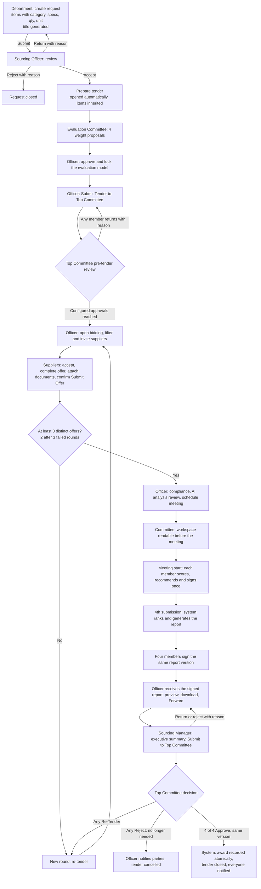

# Workflow redesign — request to award (November 2026)

This document records the corrected procurement workflow implemented on branch `Ahmad2` (FinalVersion worktree). Where it
conflicts with older descriptions in `TenderingOrangeSystem.md`, `UNIFIED_TENDER_FLOW.md` or the delivery records, this
document and the code win.

> The system calculates. AI assists. The Evaluation Committee evaluates, recommends, approves and signs. The Sourcing
> Officer forwards. The Sourcing Manager prepares the executive summary. The Top Committee makes the final decision.
> The system finalizes the award automatically.

## Corrected workflow

There is no routine return to the Evaluation Committee for signing after the Officer receives the report, and no Sourcing
Manager approval or acknowledgement after the Top Committee's unanimous decision.

## What changed, stage by stage

| Stage | Before | Now |
|---|---|---|
| Purchase request | Free-text title; items without category; free-text unit; specifications optional | Department, requester, date and status are shown from the account/system; the title is generated (`Laptop + 1 more item — IT Department`); every item needs a category (Admin-managed list), specifications, a quantity (> 0, 3 decimals) and a listed unit. Items come first on the page. |
| Officer acceptance | Redirected to the request list | Row-locked, idempotent decision; accepting redirects to `/SourcingOfficer/PurchaseRequests/Prepare/{id}`, which opens the tender form for that request (or the existing tender). The Officer also gets a "Prepare the tender" task notification. |
| Tender preparation | Items re-typed into "technical requirements" | Items (with categories, quantities, units, specifications) are copied unchanged; the form asks only for additional official requirements and the documents every supplier must attach. |
| Pre-tender approval | Did not exist | `Submit Tender to Top Committee` after the weights are locked. Top members approve or return with a reason; bidding cannot open before approval. Each attempt and vote is kept. |
| Supplier selection | Name/category search | Also filters by verified/valid company documents and by verified participation/award history; tender item categories are pointed out; clear-filters; confirmation before sending. |
| Supplier offer | Draft first, then a separate upload + submit page; one "Tax" field; all costs always visible | One page and one action: **Submit Offer** with a confirmation dialog. Item lines (offered product, specs, notes, unit price excl. tax), commercial terms, conditional additional costs, explicit tax method (rate on items, optionally on charges, or a stated total amount), warranty/deviations, typed attachments with required documents from the tender, live summary. The server validates everything and stores the offer, files and submission in one transaction. |
| Meeting notification | Plain text "The meeting opens at its scheduled start time" | A meeting page (lobby) before, during and after; it links to the evaluation workspace. The video room opens at the start time. |
| Evaluation | Two score boxes in a popup | Evaluation workspace: tender/meeting summary, the locked model, the request, supplier comparison (prices, tax, charges, delivery, warranty, terms, validity, deviations, documents, verified history), AI analysis marked advisory, then one form with scores (one decimal), a recommendation (justification required when it differs from the member's own top score), concerns and the signature. |
| Report & signing | Officer had to "send the report for signing"; Officer could regenerate | The fourth submission generates the report; members can sign at once; four signatures complete it and notify the Officer. `SendReport`/`RegenerateReport` endpoints and service methods were removed. |
| Manager | Approve/Reject with a comment | Executive summary page (pre-filled from recorded facts, saved as drafts, locked on submission). Submitting signs the Manager section and opens the Top decision. Approval without a submitted summary is refused by the server. |
| Top decision | Justification always required; 3 of 4 approvals; then Manager acknowledgement and Officer award | Approve needs no justification (a hidden value is never stored); Reject/Re-Tender need 10–2000 characters. The fourth distinct approval awards the recommended offer in the same transaction, notifies the department, Officer, both committees and each supplier (own result only). A Reject/Re-Tender goes straight to the Officer. |

## Business rules kept

- 4/4 unanimous approval of the same report version by the Evaluation Committee (signatures) and by the Top Committee.
- Approved weights: member score = financial × Wf + technical × Wt; final = average of the four member scores at full
  precision; exact ties at rank 1 block the award. No price, delivery or member-weighting formula was added.
- Minimum offers (3, or 2 after three failed rounds), rounds (maximum 4), compliance before evaluation, AI as advisory
  input only, immutable submitted offers, report versioning and narrative revision routes.

## Precision

| Value | Rule (server) |
|---|---|
| Evaluation scores typed by members | 0–100, at most one decimal; refused otherwise (never silently rounded). Stored as entered; calculations keep full precision; displays use one decimal. |
| Weight proposals | at most two decimals, total 100 |
| Money in offers | JOD three decimals, USD/EUR two; refused if more. Columns widened from `decimal(18,2)` to `decimal(19,3)` (lossless). |
| Quantities | three decimals; offered quantity must equal the requested quantity (no approved partial-offer rule) |
| Delivery days / warranty months | whole numbers |
| Tax rate | 0–100 %, two decimals; tax amount rounded once to the currency's decimals |

## Database migration `20261119211907_WorkflowRedesign` (additive, no data deleted)

- `ProcurementCategories` (seeded with 14 categories whose names match supplier registration categories) and nullable
  `CategoryId` on `PurchaseRequestItems` and `TenderItems` (old items keep `NULL`).
- `Tenders.RequiredDocuments`.
- `Bids`: `TaxRate`, `TaxIncludesCharges`, `MaintenanceDescription`, `OtherCostDescription`, `WarrantyMonths`, `WarrantyType`,
  `WarrantyTerms`, `Deviations`, `AfterSalesSupport`; cost columns widened to `decimal(19,3)`.
- `BidItems`: `OfferedProduct`, `Notes`; `UnitPrice` widened to `decimal(19,3)`.
- `EvaluationParticipation`: `RecommendedBidId`, `RecommendationReason`, `Concerns`.
- `PreTenderReviews`, `PreTenderVotes`.

The application applies migrations at startup for local (non-hosted) databases. `appsettings.json` now sets
`TopQuorum`/`TopApprovalsRequired` to 4, `RejectVoteBlocksAward` to true and `PreTenderApprovalsRequired` to 4.

## Open business decisions (not invented)

1. **Pre-tender approval threshold.** No approved rule exists. It is configuration (`TenderApprovalPolicy:PreTenderApprovalsRequired`, set to 4 as a conservative default), frozen per attempt, separate from the final 4/4 award rule; a single Return sends the tender back. Confirm the threshold and whether a Top member may reject (cancel) at this stage.
2. **Criterion-level and automatic scoring.** The approved model has two criteria (Financial, Technical) with locked weights. Sub-criteria, a price-normalization formula or automatic delivery/warranty scoring were not approved, so members still enter both criterion scores; the workspace shows the data and guidance.
3. **Tie at rank 1.** Still blocks the award; the Top Committee can no longer approve a tied report (it must Re-Tender or Reject).
4. **Partial offers and alternative items.** Not supported (offered quantity must equal requested quantity).
5. **Multi-currency comparison.** Offers in different currencies are shown side by side with a warning; no exchange-rate rule.
6. **Tax basis for additional charges.** The supplier states whether the rate also applies to the charges; no automatic assumption.
7. **Frozen older policies.** Sessions that froze a 3-of-4 Top policy before this change still need four approvals for the automatic award (the confirmed rule).

## Legacy data

- Final-decision notices created before the change in status `AwaitingManager` can still be acknowledged by the Manager, and the Officer's legacy `Award`/`Notify Suppliers` actions remain for them. New decisions never use them.
- Draft offers saved before the change open in the new offer form and are submitted from there.
- Request/tender items without a category display "—".

## Tests (real SQL Server, isolated `OrangeAuthCheck_*` databases)

Run from `Orange-Tendering-System/` after `dotnet build Tests/AuthSmoke/AuthSmoke.csproj -c Release -p:UseAppHost=false`:

| Command | Result (20 Nov 2026) |
|---|---|
| `dotnet Tests/AuthSmoke/bin/Release/net10.0/AuthSmoke.dll --workflow-redesign-checks` | 46 passed |
| `... --unified-tender-checks` | 167 passed |
| `... --top-decision-checks` (`AUTH_TEST_CONNECTION` = new `OrangeAuthCheck_TopReasons_*`) | 97 passed |
| `... --retender-checks` (`AUTH_TEST_CONNECTION` = new `OrangeAuthCheck_Retender_*`) | passed |

Set `AUTH_PROJECT_ROOT` to the web project folder. `--final-decision-checks` needs the Playwright lifecycle fixture and was
not run. Pages were verified through server-rendered HTTP responses, not by a visual browser review.

## Manual verification

1. Department: New Request → add two items with categories → submit; the title is generated.
2. Officer: Request → Details → Accept and prepare the tender → the tender form opens with the request; create it.
3. Committee members propose weights → Officer approves → Submit Tender to Top Committee → four Top members approve in the tender popup → Officer opens bidding and invites suppliers.
4. Supplier: accept → Prepare my offer → fill the page, attach the required documents → Submit Offer → confirm.
5. Officer: close bidding, run and review the AI analysis, schedule the meeting.
6. Committee member: open the meeting notification before the start (lobby + workspace, no scoring); at the start, score, recommend and sign; after the fourth member the report appears; all sign.
7. Officer: Forward to Sourcing Manager. Manager: Prepare the executive summary → Submit.
8. Top members: Approve (no reason box) ×4 → tender shows Awarded; suppliers, department and committees are notified.
